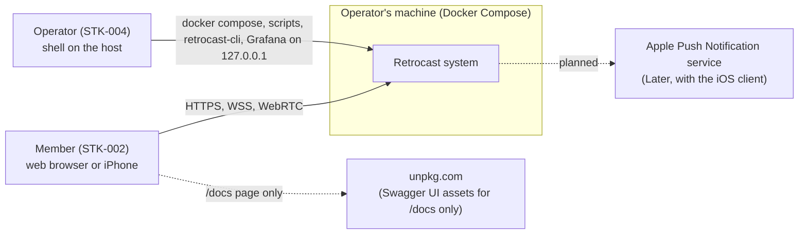
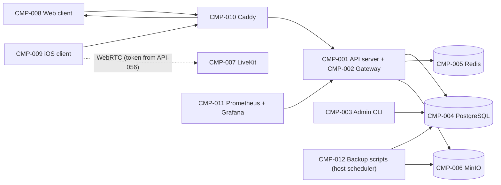
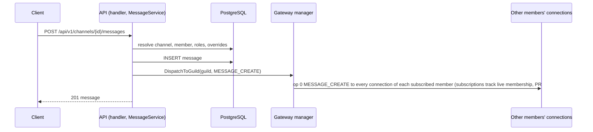
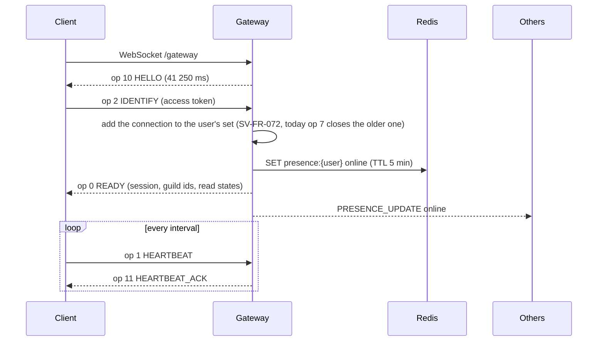
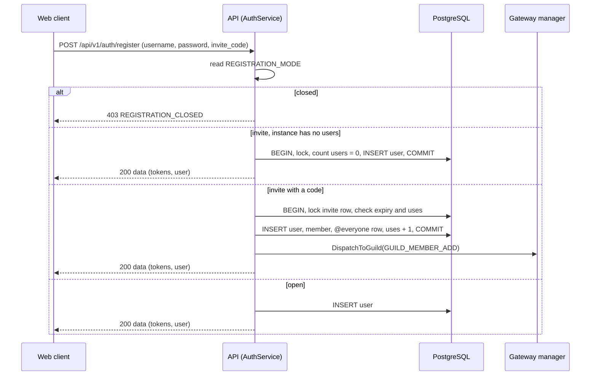
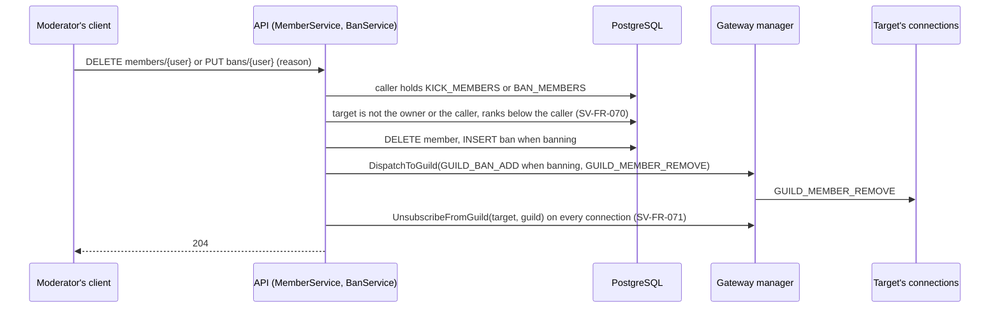

# Retrocast — Architecture

Status: Baselined (rev 9)
Related: [SRS](SRS.md) · [Data Contracts](DATA_CONTRACTS.md) · [Product Brief](PRODUCT_BRIEF.md)

It describes the system as built at commit `6bc385e`, re-read at `origin/main` 55e50eb
(PR #23 merged) in rev 2, and the target design that rev 2 decides (ADR-013–ADR-020). Design
intent comes from `SYSTEM_DESIGN.md`; where the code differs, the code is described and the
difference noted. The older prose architecture is `docs/legacy/architecture.md` (Q-034).

## 1. Introduction and goals
- Goals: GOAL-001 (5–20 people chatting in real time on one self-hosted machine), GOAL-002
  (persistent voice rooms), GOAL-003 (early-Discord scope), GOAL-004 (data stays local).
- Quality priorities, in the order the seed implies: data stays local (SYS-NFR-003), correct
  authorisation (SV-FR-045), real-time delivery (SV-FR-026, SYS-NFR-002), simple operation on
  one host (SYS-CON-001). Numeric targets: SYS-NFR-001, SYS-NFR-002 and SYS-NFR-007 (Q-031).
- Stakeholders: STK-001 owner, STK-002 member, STK-003 server owner or admin, STK-004
  operator, STK-005 App Store review (PRODUCT_BRIEF §3).

## 2. Constraints
SYS-CON-001 (one host, Docker Compose), SYS-CON-002 (no third-party account or email),
SYS-CON-003 (existing stack, permission resolution in Go), SYS-CON-004 (all rights
reserved, Q-007). The Go module path stays `github.com/victorivanov/retrocast` (ADR-020).

## 3. System context (C4 level 1)

No core flow leaves the host (SYS-NFR-003). The `/docs` page is the one place a browser loads
an outside asset.

## 4. Solution strategy
- One Go process serves REST and the WebSocket gateway, so a request can dispatch an event
  in memory with no broker (ADR-001).
- PostgreSQL holds durable data; Redis holds short-lived state; MinIO holds files (ADR-002–
  ADR-004).
- LiveKit carries voice; the Go server only issues room tokens (ADR-005).
- Clients are thin: React in the browser and SwiftUI on iOS, both on the same REST and
  gateway contracts (PRN-003, ADR-008).
- Caddy terminates TLS in front of everything (ADR-010).

### 4.1 Stack decision
Recorded at major-version level from the Stack Profile (generated locally, not committed).
PR #23 (merged, 55e50eb) moved the Go toolchain to 1.26.11 in go.mod, CI and the Dockerfile
and refreshed dependencies within the same major versions.

| Tier | Choice | Version | Evidence |
|---|---|---|---|
| Server language | Go | 1.26 (go.mod `go 1.26.11`; CI and the `golang:1.26.11-alpine` builder) | retrocast/go.mod; .github/workflows/ci.yml; retrocast/Dockerfile |
| Server runtime image | Alpine Linux | 3.24 (non-root `appuser`, UID 1001; `HEALTHCHECK` on `/health`) | retrocast/Dockerfile |
| HTTP framework | Echo | v4 | retrocast/go.mod |
| PostgreSQL driver | pgx | v5 | retrocast/go.mod |
| Redis client | go-redis | v9 | retrocast/go.mod |
| WebSocket | gorilla/websocket | v1 | retrocast/go.mod |
| Tokens | golang-jwt | v5 | retrocast/go.mod |
| Password hashing | golang.org/x/crypto argon2 | v0 | retrocast/go.mod |
| Migrations | golang-migrate | v4 | retrocast/go.mod |
| Object store client | minio-go | v7 | retrocast/go.mod |
| Database | PostgreSQL | 17 | retrocast/docker-compose.yml; CI service |
| Cache and ephemeral state | Redis | 7 | retrocast/docker-compose.yml; CI service |
| Object store | MinIO | unpinned (`latest`) | retrocast/docker-compose.yml |
| Voice | LiveKit server | unpinned (`latest`) | retrocast/docker-compose.yml |
| Edge | Caddy | 2 | retrocast/docker-compose.yml; retrocast/Caddyfile |
| Web client | React, React Router, Zustand, Tailwind CSS, react-markdown | 19, 7, 5, 4, 10 | retrocast-web/package.json |
| Web build | Vite, TypeScript, ESLint, pnpm, Node | 7, 5, 9, 10, 22 | retrocast-web/package.json; retrocast-web/Dockerfile |
| Web serving | nginx | unpinned (`alpine`) | retrocast-web/Dockerfile |
| iOS client | Swift, SwiftUI, XcodeGen | Swift 6; iOS 17 target | retrocast-client/Retrocast/project.yml |
| Monitoring | Prometheus, Grafana | unpinned (`latest`) | retrocast/docker-compose.yml |
| CI | GitHub Actions; golangci-lint | v2 | .github/workflows/ci.yml |

PR #22 (open) proposes a Rust core for permission resolution; it is not part of this stack.
The owner keeps resolution in Go and decides PR #22 after the authorisation defects are fixed
(ADR-009, Q-008).

## 5. Components (C4 level 2)

| ID | Component | Technology | Responsibility | Code | Requirements |
|---|---|---|---|---|---|
| CMP-001 | API server | Go, Echo | REST `/api/v1`: handlers, services (business rules, permissions), repositories; `/health`, `/metrics`, `/docs` | retrocast/cmd/retrocast; internal/api, internal/service, internal/database, internal/auth, internal/permissions | SV-FR-001–SV-FR-070, SV-FR-074–SV-FR-077, SV-IR-001, SV-IR-003–SV-IR-008, SV-NFR-001–SV-NFR-011, SV-NFR-013 |
| CMP-002 | Gateway | Go, gorilla/websocket (same binary as CMP-001) | Sessions, heartbeats, presence, event fan-out, replay buffer | retrocast/internal/gateway | SV-FR-026, SV-FR-031–SV-FR-039, SV-FR-071, SV-FR-072, SV-IR-002, SV-NFR-011 |
| CMP-003 | Admin CLI | Go | `migrate`, `seed`, `health`, `version` (run on the host; not in the server image) | retrocast/cmd/retrocast-cli | SV-FR-073 |
| CMP-004 | PostgreSQL | PostgreSQL 17 | Durable entities ENT-001–ENT-018; full-text search | retrocast/migrations | SV-NFR-007, SV-FR-059 |
| CMP-005 | Redis | Redis 7 (append-only file on) | ENT-019–ENT-021 | retrocast/internal/redis | SV-FR-005, SV-FR-032–SV-FR-034, SV-FR-061, SV-NFR-003, SV-NFR-010 |
| CMP-006 | MinIO | MinIO | ENT-022 attachments | retrocast/internal/storage | SV-FR-051, SV-FR-052 |
| CMP-007 | LiveKit | LiveKit server | Voice rooms (WebRTC SFU) | retrocast/internal/service/voice.go (token minting only) | SV-FR-048, SV-IR-006 |
| CMP-008 | Web client | React SPA on nginx | Browser UI; nginx proxies `/api` and `/gateway` | retrocast-web | WEB-FR-001–WEB-FR-024, WEB-NFR-001, WEB-NFR-002 |
| CMP-009 | iOS client | SwiftUI | iPhone UI (follows the web client, Q-004) | retrocast-client | IOS-FR-001–IOS-FR-012, IOS-NFR-001 |
| CMP-010 | Edge proxy | Caddy 2 | TLS; routes `/api/*`, `/gateway`, `/health` to CMP-001 and the rest to CMP-008; the only client entry point (ADR-016) | retrocast/Caddyfile | SV-NFR-008, SV-NFR-009, SV-NFR-011, SV-NFR-012 |
| CMP-011 | Monitoring | Prometheus, Grafana | Scrapes `api:8080/metrics` every 15 s; provisioned "Retrocast API" dashboard; Grafana for the operator on 127.0.0.1 (ADR-016) | retrocast/prometheus.yml; retrocast/grafana | SV-NFR-012, SV-NFR-013, SYS-FR-001 |
| CMP-012 | Backup and restore | Bash scripts run by a host scheduler (cron or launchd) | Daily PostgreSQL dump and MinIO archive, 30-day retention, restore into a fresh stack (ADR-018) | retrocast/scripts/backup.sh, restore.sh | SYS-FR-002–SYS-FR-004, SYS-NFR-005, SYS-NFR-006 |

Inside CMP-001, requests pass handler → service → repository. Services own validation and
permission checks (`internal/service/permission.go`) and call the gateway manager to dispatch
events.
`docs/legacy/architecture.md` predates the service layer.

### 5.1 Runtime views

Sending a message (SV-FR-025, SV-FR-026):

Connecting (SV-FR-035–SV-FR-038, SV-FR-072):

Joining voice (SV-FR-048): the client calls API-056; the server checks `CONNECT`, writes a
voice state, mints a LiveKit token for room `voice-{channel id}` and dispatches
VOICE_STATE_UPDATE. The client must already know the LiveKit URL. The iOS client requests the
token but has no LiveKit SDK (IOS-FR-011).

Refreshing a session (SV-FR-005): the client posts the refresh token; the server reads
and deletes `refresh:{token}` atomically with Redis GETDEL, then issues a new pair (PR #54).

Registering (SV-FR-062–SV-FR-065, ADR-014):

Kicking or banning (SV-FR-066–SV-FR-071):

Changing a password (SV-FR-060, SV-FR-061): the client sends API-059 with the current and the
new password; the server checks the current Argon2id hash, stores the new hash, deletes every
refresh token of the user and returns a new pair. Deleting them all needs a per-user index of
refresh tokens in Redis (for example a set per user), which ENT-019 lacks today. Access tokens
already issued expire within 15 minutes.

Backing up and restoring (SYS-FR-002–SYS-FR-004, ADR-018): a cron or launchd job on the host
runs `scripts/backup.sh` daily from `retrocast/`; it writes `backup_<time>.sql.gz` (pg_dump)
and `minio_<time>.tar.gz` (the MinIO data directory) to `BACKUP_DIR` and deletes archives
older than 30 days. `scripts/restore.sh` feeds one dump to `psql` in the db container and can
unpack the MinIO archive. Before each release the operator restores the latest backup into a
fresh stack and records the file, the date and the row counts before and after
(SYS-NFR-006).

## 6. Deployment view
- One host runs `retrocast/docker-compose.yml`: api, db, redis, minio, livekit, web, caddy,
  prometheus, grafana. Volumes: pgdata, minio-data, redis-data, caddy_data, prometheus-data,
  grafana-data.
- Published ports (ADR-016, PR #53): Caddy 80/443 and LiveKit 7880/7881 and UDP
  50000-50100; Grafana binds only to 127.0.0.1:3000. API 8080, MinIO 9000/9001
  and Prometheus 9090 stay internal. Caddy returns 404 for /metrics.
- The api container runs as the non-root `appuser` (UID 1001) with migrations in
  `/migrations` and a `HEALTHCHECK` on `/health` every 30 s. Redis runs with the append-only
  file on. At start the server loads configuration, connects to PostgreSQL, applies pending
  migrations, connects to Redis and MinIO, then serves HTTP.
- LiveKit uses valid YAML key syntax and `--udp-port 50000-50100` (hyphen form),
  providing UDP mux listeners within the published range (PR #53 round 2).
- CI (`.github/workflows/ci.yml`) builds and pushes the api and web images to GHCR on `main`.
  No deploy job exists. The product is self-hosted only (Q-002); there is no public demo
  (Q-005).
- Backups: CMP-012, scheduled on the host (ADR-018).

## 7. Cross-cutting concepts

### 7.1 Authentication
Username and password; Argon2id hashes (SV-NFR-001); HS256 access token for 15 minutes and
an opaque refresh token in Redis for 7 days with rotation (SV-NFR-002). The gateway accepts the
access token in IDENTIFY and RESUME.

### 7.2 Authorisation
Permission bitfields on roles and per-channel allow and deny overrides
(DATA_CONTRACTS §3.1). Owner and Administrator bypass every check (SV-FR-046). Channel checks
follow DATA_CONTRACTS section 3.2; guild checks include the default role and role management requires MANAGE_ROLES (PR #44).
Kick and ban act only on members ranked below the caller (SV-FR-070; kick fixed in PR #44).
Resolution is in Go (ADR-009).

### 7.3 Real-time delivery
In-process fan-out from services to gateway connections, keyed by current guild membership; IDENTIFY retries a snapshot if a join or removal changed the user membership epoch before registration. Per-connection send buffer of 256 frames. A 100-event replay
buffer per session backs RESUME (PR #50); missing history receives fresh READY. A user may hold several connections
(ADR-017) and subscriptions follow joins and removals (SV-FR-071). Live devices update in place; retained disconnected sessions receive fresh READY after either change, including a join from another live device.

### 7.4 Configuration and secrets
Environment variables override the optional `KEY = VALUE` file, which overrides the defaults
(DATA_CONTRACTS §1). Rev 2 adds `REGISTRATION_MODE` and `ALLOWED_ORIGINS`. Secrets live in
`retrocast/.env`, which is not committed; `.env.example` and `retrocast.toml.example` hold
development defaults. `JWT_SECRET` has no minimum length check.

### 7.5 Observability
JSON request logs through slog (SV-NFR-006); `/health` checks PostgreSQL and Redis
(SV-NFR-005); Prometheus metrics at `/metrics` (SV-NFR-013), scraped every 15 s, with a
provisioned Grafana dashboard (SYS-FR-001); `/metrics` stays inside the compose network
(SV-NFR-012).

### 7.6 Error handling
One JSON error envelope with stable codes (DATA_CONTRACTS §5), except for the JWT middleware (SV-IR-003). Every success body is `{"data": …}` from REST contract
v2.0.0 (SV-IR-007, ADR-013).

### 7.7 Identifiers
Snowflake ids generated in-process (`internal/snowflake`), serialised as strings
(SV-IR-004), with two exceptions (D-11).

## 8. Architecture decisions

ADR-001–ADR-012 record decisions already present in the code; status `Accepted` means "in
the code". ADR-013–ADR-020 record rev 2 decisions; `Accepted (rev 2, not built)` means decided
but not yet in the code. The Source column says who decided: Q- ids are the owner's answers
(PRODUCT_BRIEF §14); a design choice made within an answer is marked as the driver's or the
spec lead's.

| ID | Decision | Context and alternatives | Status | Consequences | Source |
|---|---|---|---|---|---|
| ADR-001 | One Go binary serves REST and the WebSocket gateway | Separate gateway service or a broker; at 5–20 users one process suffices | Accepted | No horizontal scaling; events dispatch in memory | SYSTEM_DESIGN.md:121–150; retrocast/cmd/retrocast |
| ADR-002 | PostgreSQL is the only durable store, including full-text search | Separate search engine | Accepted | Search uses English stemming (kept by Q-023) | SYSTEM_DESIGN.md:132–140; migrations/000015 |
| ADR-003 | Redis holds refresh tokens, presence, typing and rate-limit counters | Keep them in PostgreSQL or memory | Accepted | Losing Redis signs everyone out; unused `refresh_tokens` table remains | internal/redis/client.go |
| ADR-004 | MinIO stores attachments | Local disk | Accepted | URLs need a public path (D-10) | SYSTEM_DESIGN.md:192; internal/storage |
| ADR-005 | LiveKit carries voice; the server only mints tokens without an SDK | Pion directly | Accepted | No webhooks, so voice state can go stale | SYSTEM_DESIGN.md:152–161; internal/service/voice.go |
| ADR-006 | Snowflake ids, JSON strings | UUIDs; database sequences | Accepted | Time-ordered ids give cursor paging | SYSTEM_DESIGN.md:543; internal/snowflake |
| ADR-007 | Short JWT access token plus rotating opaque refresh token; Argon2id | Sessions in cookies | Accepted | Clients must store the rotated token (D-15) | SYSTEM_DESIGN.md:230; internal/auth |
| ADR-008 | The web client is React with Vite, not the SvelteKit app SYSTEM_DESIGN recommends | SvelteKit (SYSTEM_DESIGN.md:173–181); Tauri desktop wrapping it (CAP-029) | Accepted | The Tauri plan assumed SvelteKit; the desktop app is Won't (Q-028) | retrocast-web/package.json |
| ADR-009 | Permission resolution stays in Go (`internal/permissions`, `internal/service/permission.go`) | PR #22 proposes a required Rust core | Accepted (confirmed by the owner, Q-008; PR #22 is decided after the authorisation defects are fixed) | Adopting PR #22 would change the build, CI and contributor toolchain | internal/permissions; PR #22; Q-008 |
| ADR-010 | Caddy terminates TLS; nginx serves the web build | Expose the API directly | Accepted | API and MinIO ports are internal (PR #53) | retrocast/Caddyfile; retrocast-web/nginx.conf |
| ADR-011 | Single-host Docker Compose deployment | Kubernetes; managed cloud | Accepted | No high availability (SYS-CON-001) | SYSTEM_DESIGN.md:196; retrocast/docker-compose.yml |
| ADR-012 | Handlers call services, services call repositories behind interfaces | Handlers calling the database | Accepted | Handler tests run on mock repositories; `internal/service` has no tests of its own | retrocast/internal |
| ADR-013 | Every REST success body is `{"data": …}` and errors stay `{"error": {code, message}}`; the path stays `/api/v1`; OpenAPI `info.version` becomes 2.0.0; no parallel old-shape API is served | The owner chose one wrapped shape as a new major version (Q-010). For the version itself the alternatives were a `/api/v2` path served beside v1, or a negotiated version header. Both keep a second shape alive for clients that do not exist: nothing is released, the web client already reads `data`, and the iOS client follows the web client (Q-004), so it is updated when it is scheduled. A major version number in OpenAPI marks the break without a second route tree | Implemented (rev 7; Q-010) | Breaking for any client reading bare bodies (DATA_CONTRACTS §9); the web client must stop parsing 204 bodies (D-29); the iOS update to v2.0.0 waits for its schedule | Q-010; driver; SV-IR-007, SV-IR-008 |
| ADR-014 | Registration modes `open`, `invite` and `closed` from `REGISTRATION_MODE`, default `invite`; registering with an invite also joins its guild in the same transaction; the first account on an empty instance may register without an invite | The owner chose operator-set modes with invite-only as the default (Q-012). Without a bootstrap rule an invite-only instance with no users could never get its first user; the alternatives (a first user created with the CLI, or a one-time setup token) add an operator step. Joining on registration saves a friend holding a link a second step | Built (PR #54; accepted Q-012) | The first registration must be serialised (SV-FR-065); an operator who wants nobody to register uses `closed` and seeds users with the CLI | Q-012; SV-FR-062–SV-FR-065 |
| ADR-015 | Client IP comes from `X-Forwarded-For` only as written by the Caddy hop; unauthenticated routes (including the invite lookup) are limited per client IP and authenticated routes per user; when Redis is unreachable, unauthenticated routes fail closed with 503 and authenticated routes fail open | The owner chose the proxy trust and the limit keys (Q-015). The failure policy is the spec lead's: guessing and enumeration happen on sign-in, registration and the invite lookup; sign-in already needs Redis for refresh tokens, so failing closed there costs no extra availability; access tokens are checked without Redis, so members already signed in keep chatting; the 15-minute token lifetime and a small trusted group bound the abuse. Failing open everywhere (today) lets guessing run unthrottled during an outage; failing closed everywhere stops all chat when an ephemeral store fails | Accepted, built (PR #23 and PR #53) | Port 8080 is unpublished (PR #53) | Q-015; SV-NFR-003, SV-NFR-009, SV-NFR-010 |
| ADR-016 | Browsers are served only for the same origin and `ALLOWED_ORIGINS`, for CORS and gateway upgrades; requests without an Origin header (native clients) are served. Compose publishes only Caddy 80 and 443 and LiveKit 7880, 7881 and UDP 50000–50100; Grafana binds to 127.0.0.1:3000; 8080, 9000, 9001 and 9090 are not published | The owner chose the same origin plus an operator list, and only Caddy's ports (Q-016). LiveKit's ports stay because WebRTC media does not pass through Caddy; Grafana on loopback keeps the operator's dashboard (CAP-035) without exposing it (spec lead's details) | Accepted, built (PR #53) | `retrocast-cli health` needs `SERVER_URL` set to the public address; MinIO is reachable only inside the network until pre-signed URLs go through Caddy (ADR-019) | Q-016; SV-NFR-008, SV-NFR-011, SV-NFR-012 |
| ADR-017 | A user may hold several gateway connections; each receives every event for the user; presence turns offline 10 s after the last one closes; there is no per-user cap | The owner chose several devices at once (Q-009). No cap is set because the group is 5–20 trusted people (spec lead's assumption) | Built (PR #50) | The manager's per-user entry is a set of connections; READY and RESUME stay per connection; EVT-007 is not sent for a second IDENTIFY | Q-009; SV-FR-071, SV-FR-072 |
| ADR-018 | A host scheduler (cron on Linux, launchd on macOS) runs `scripts/backup.sh` daily from `retrocast/`; archives older than 30 days are deleted; Redis is not backed up | The owner chose daily backups kept 30 days and a restore drill before each release (Q-030). A scheduler container was not chosen because `backup.sh` drives `docker compose exec`, which runs on the host. Redis holds only refresh tokens, presence, typing and counters, so losing it signs users out and loses nothing else (spec lead's design) | Accepted (rev 2, not built) | A restore signs everyone out; backups hold secrets and personal data, so `BACKUP_DIR` should be readable by the operator only | Q-030; SYS-FR-002–SYS-FR-004, SYS-NFR-006 |
| ADR-019 | Clients upload and download attachments through pre-signed MinIO URLs valid 15 minutes and served through the public entry point (Caddy) | The owner chose pre-signed URLs (Q-011); the 15-minute lifetime is the spec lead's and matches the access-token lifetime | Accepted (rev 2, Later, not built) | Caddy needs a route to MinIO; each history fetch mints fresh download URLs | Q-011; SV-FR-051, SV-FR-052 |
| ADR-020 | Keep the Go module path `github.com/victorivanov/retrocast` | The repository lives at LLRHook/retrocast; renaming the module changes every import (Q-033) | Accepted (the owner's answer, Q-033) | `go install` by repository URL does not resolve the module | Q-033; LIM-005 |

Assumptions made by the spec lead in rev 2 (not the owner's answers; each can be changed by a
later revision without breaking an accepted decision):
- Load profile for the performance targets: 20 connected clients, each sending one message
  every 10 s (SYS-NFR-001).
- Existing guilds keep the `@everyone` permissions they have stored; only new guilds get
  `DefaultEveryonePerms` (SV-FR-008, D-27).
- The web client keeps the refresh token in `localStorage` for the Pilot (WEB-FR-003).
- A wrong current password on API-059 returns 403, not 401, so the client does not treat it as
  an expired session (SV-FR-060).
- WCAG 2.2 AA and the browser list are `Should`, not `Must` (WEB-NFR-001, WEB-NFR-002).

## 9. Risks and technical debt

Brief risks RISK-001–RISK-012 are in PRODUCT_BRIEF §11. The defects below were found by
reading the code; D-08 and D-09 were also reproduced on PostgreSQL 17 with all migrations
applied. Rev 2 adds the compose smoke run of 2026-11-23 on 55e50eb's tree, which confirmed
D-01–D-06, D-14, D-17, D-18 and D-25 and the reaction part of D-11; D-15 and D-16 were not
reached. "Pilot" in Blocks marks a defect that blocks a Pilot requirement (SRS §1.8). Issue
links the GitHub issue that tracks it, where one exists. D-08 and D-09 block the Pilot
through RISK-002, which Q-003 requires fixed, although the DM and upload capabilities
they affect stay Later.

| ID | Defect | Evidence (file:line) | Affects | Blocks | Issue |
|---|---|---|---|---|---|
| D-01 | Fixed in [PR #44](https://github.com/LLRHook/retrocast/pull/44). Previous defect: Role and override management checks no `MANAGE_ROLES`; the hierarchy check allows negative positions, so a member with no roles can create an Administrator role at position -1 and assign it to themself | retrocast/internal/service/role.go:49; retrocast/internal/service/role.go:223; retrocast/internal/service/role.go:313; retrocast/internal/service/permission.go:168 | SV-FR-040–SV-FR-043, SV-FR-047 | Pilot | [#26](https://github.com/LLRHook/retrocast/issues/26) |
| D-02 | Fixed in [PR #44](https://github.com/LLRHook/retrocast/pull/44). Previous defect: Update and delete do not check that the role belongs to the guild in the path; a new position is not checked against the caller's highest role | retrocast/internal/service/role.go:116; retrocast/internal/service/role.go:181 | SV-FR-041, SV-FR-042 | Pilot | [#27](https://github.com/LLRHook/retrocast/issues/27) |
| D-03 | Fixed in [PR #44](https://github.com/LLRHook/retrocast/pull/44). Previous defect: Listing roles checks no membership | retrocast/internal/service/role.go:96 | SV-FR-044 | Pilot | [#28](https://github.com/LLRHook/retrocast/issues/28) |
| D-04 | Fixed in [PR #44](https://github.com/LLRHook/retrocast/pull/44). Previous defect: Guild-level checks combine only assigned roles, and invite joiners get no `@everyone` row, so `@everyone` guild permissions do not apply to them | retrocast/internal/service/permission.go:125; retrocast/internal/service/invite.go:173-181 | SV-FR-045, SV-FR-020 | Pilot | [#29](https://github.com/LLRHook/retrocast/issues/29) |
| D-05 | Fixed: subscriptions follow create/join/leave/kick/ban and guild deletion, only for live users (PR #50) | retrocast/internal/gateway/manager.go; session_live_test.go | SV-FR-026, SV-FR-020, SV-FR-066, SV-FR-071 | Pilot | [#30](https://github.com/LLRHook/retrocast/issues/30) |
| D-06 | Fixed: search filters VIEW_CHANNEL/READ_MESSAGE_HISTORY (PR #44); content fan-out caches definitive permission results and invalidates on roles, membership, overrides and channel changes; lookup faults close and resynchronize the session; channel create/delete metadata are guild-wide (PR #50) | retrocast/internal/gateway/manager.go; session_live_test.go | SV-FR-026, SV-FR-059, SV-FR-016 | Pilot | [#31](https://github.com/LLRHook/retrocast/issues/31) |
| D-07 | Fixed: session-scoped serialized replay with original sequences; valid token plus unavailable replay receives fresh READY/new session id (PR #50) | retrocast/internal/gateway/manager.go; session_live_test.go | SV-FR-038 | Pilot | — |
| D-08 | Fixed: migration 000020 validates and key-share-locks guild/DM message parents and deletes messages on parent deletion | retrocast/migrations/000020_dm_messages_and_pending_attachments.up.sql; internal/service/storage_integration_test.go; internal/database/storage_migration_test.go | SV-FR-055, WEB-FR-016, IOS-FR-009; RISK-002 | Pilot (RISK-002, Q-003) | [#37](https://github.com/LLRHook/retrocast/issues/37) |
| D-09 | Fixed: pending uploads carry uploader/channel ownership and are atomically claimed through API-022; batched hydration returns attachments | retrocast/migrations/000020_dm_messages_and_pending_attachments.up.sql; internal/service/storage_integration_test.go; internal/database/storage_migration_test.go | SV-FR-051, WEB-FR-017; RISK-002 | Pilot (RISK-002, Q-003) | [#24](https://github.com/LLRHook/retrocast/issues/24) |
| D-10 | Attachment URLs use the compose-internal MinIO address over `http://` | retrocast/internal/storage/minio.go:56–58 | SV-FR-052, SV-NFR-008 | Later | — |
| D-11 | `Member.roles`, READY `guilds` and reaction user lists (API-032) serialise ids as JSON numbers; JavaScript loses precision above 2^53 | retrocast/internal/models/member.go:10; internal/gateway/events.go:78; internal/service/reaction.go | SV-IR-004, SV-FR-075 | Pilot | [#36](https://github.com/LLRHook/retrocast/issues/36) Fixed in [PR #45](https://github.com/LLRHook/retrocast/pull/45). |
| D-12 | Fixed in [PR #54](https://github.com/LLRHook/retrocast/pull/54). Previous defect: Guild creation runs eight writes without a transaction | internal/service/; internal/database/transaction.go; internal/redis/client.go; test: internal/api/atomicity_live_test.go | SV-FR-007 | — | — |
| D-13 | Anonymous Redis failures return 503; authenticated traffic fails open; invite lookup limited; API unpublished | retrocast/internal/api; internal/origin; internal/gateway; docker-compose.yml; Caddyfile | SV-NFR-003, SV-NFR-009, SV-NFR-010 | Fixed | [PR #53](https://github.com/LLRHook/retrocast/pull/53) |
| D-14 | Clients and server disagree on the response envelope: the web client always reads `json.data`; the iOS refresh path accepts only the wrapped form. The smoke run saw web sign-in fail after a 200. Fixed on the server side by SV-IR-007 (ADR-013) | retrocast-web/src/lib/api.ts:113; retrocast-client/Retrocast/Sources/Networking/APIClient.swift:211 | SV-IR-007, WEB-FR-002, WEB-FR-003, WEB-FR-005, WEB-FR-007, WEB-FR-012, WEB-FR-013, IOS-FR-002 | Pilot | [#32](https://github.com/LLRHook/retrocast/issues/32) Fixed in [PR #45](https://github.com/LLRHook/retrocast/pull/45). |
| D-15 | The web client keeps the old refresh token after rotation | retrocast-web/src/stores/auth.ts:83–93 | WEB-FR-003 | Pilot | — Fixed in [PR #45](https://github.com/LLRHook/retrocast/pull/45). |
| D-16 | The web client revokes invites at `/invites/{code}` without `/api/v1` | retrocast-web/src/components/InviteModal.tsx:42 | WEB-FR-012 | Pilot | — Fixed in [PR #45](https://github.com/LLRHook/retrocast/pull/45). |
| D-17 | REST and gateway share exact origin checks; own origin, ALLOWED_ORIGINS and native clients served | retrocast/internal/api; internal/origin; internal/gateway; docker-compose.yml; Caddyfile | SV-NFR-011 | Fixed | [PR #53](https://github.com/LLRHook/retrocast/pull/53) |
| D-18 | Fixed in [PR #44](https://github.com/LLRHook/retrocast/pull/44). Previous defect: The typing route checks no membership or permission and returns 404 for DM channels; `MessageService.Typing` has no route | retrocast/internal/api/router.go:197; retrocast/internal/service/message.go:233 | SV-FR-031 | Pilot | [#34](https://github.com/LLRHook/retrocast/issues/34) |
| D-19 | Fixed: READY includes shared-guild presence snapshot; authenticated heartbeat extends status TTL (PR #50) | retrocast/internal/gateway/manager.go; session_live_test.go | SV-FR-032 | Pilot | — |
| D-20 | Fixed in [PR #54](https://github.com/LLRHook/retrocast/pull/54). Previous defect: Invite `uses` is checked and incremented without a lock, so concurrent accepts can pass `max_uses` | internal/service/; internal/database/transaction.go; internal/redis/client.go; test: internal/api/atomicity_live_test.go | SV-FR-020 | — | — |
| D-21 | Fixed in [PR #54](https://github.com/LLRHook/retrocast/pull/54). Previous defect: Refresh rotation reads then deletes the token in two commands, so two concurrent refreshes can both succeed | internal/service/; internal/database/transaction.go; internal/redis/client.go; test: internal/api/atomicity_live_test.go | SV-FR-005, SV-NFR-002 | Pilot | [#43](https://github.com/LLRHook/retrocast/issues/43) |
| D-22 | Fixed: Q-017 exact content-type allowlist; SVG and unknown image subtypes refused | retrocast/internal/service/upload.go; internal/service/upload_test.go | SV-FR-051 | Later | — |
| D-23 | LiveKit tokens last 24 hours and do not reflect `SPEAK`; no webhook clears stale voice states | retrocast/internal/service/voice.go:178–197 | SV-FR-048, SV-FR-049 | — | — |
| D-24 | Users cannot be deleted while they own a guild, have messages, or have linked/pending attachments as uploader (attachments.uploader_id REFERENCES users(id), without ON DELETE) | retrocast/migrations/000002_create_guilds.up.sql; 000007_create_messages.up.sql; 000020_dm_messages_and_pending_attachments.up.sql | CAP-038 (account deletion, Later) | Later | — |
| D-25 | LiveKit uses valid YAML keys and a hyphen-delimited UDP mux range 50000-50100 (round 2 corrects the ignored colon form) | retrocast/docker-compose.yml (livekit command and LIVEKIT_KEYS) | SYS-CON-001; voice (Later) | Fixed | [PR #53](https://github.com/LLRHook/retrocast/pull/53) |
| D-26 | Only Caddy/LiveKit public ports and loopback Grafana; API, MinIO and Prometheus internal | retrocast/docker-compose.yml (service port bindings); retrocast/Caddyfile (/metrics) | SV-NFR-008, SV-NFR-009, SV-NFR-012, SYS-FR-001 | Fixed | [PR #53](https://github.com/LLRHook/retrocast/pull/53) |
| D-27 | Fixed in [PR #44](https://github.com/LLRHook/retrocast/pull/44). Previous defect: New guilds give `@everyone` 32771 (View, Send, Read history) instead of `DefaultEveryonePerms` (230147) | retrocast/internal/service/guild.go:68 | SV-FR-008 | Pilot | [#39](https://github.com/LLRHook/retrocast/issues/39) |
| D-28 | Fixed in [PR #44](https://github.com/LLRHook/retrocast/pull/44). Previous defect: Kick checks `KICK_MEMBERS` and the owner only: no role-hierarchy check and no self check (ban has both) | retrocast/internal/service/member.go:226 | SV-FR-066, SV-FR-070 | Pilot | [#40](https://github.com/LLRHook/retrocast/issues/40) |
| D-29 | The web client parses every successful response as JSON, so an empty 204 body rejects: deleting a server or channel, leaving a server and other 204 calls report failure although the server succeeded | retrocast-web/src/lib/api.ts:97–114; components/GuildSettingsModal.tsx:56–74; components/ChannelModal.tsx:56–65 | WEB-FR-006, WEB-FR-014, WEB-FR-021, WEB-FR-022, WEB-FR-024 | Pilot | [#41](https://github.com/LLRHook/retrocast/issues/41) Fixed in [PR #45](https://github.com/LLRHook/retrocast/pull/45). |
| D-30 | Web sign-out clears the local tokens without calling API-004, so the refresh token stays valid for up to 7 days | retrocast-web/src/stores/auth.ts:68–75 | WEB-FR-024 | Pilot | [#42](https://github.com/LLRHook/retrocast/issues/42) Fixed in [PR #45](https://github.com/LLRHook/retrocast/pull/45). |
| D-31 | Fixed: reaction remove/list verify that the message exists in the route channel before repository access | retrocast/internal/service/reaction.go; internal/api/reaction_handler_test.go (TestReactionRouteBinding) | SV-FR-074, SV-FR-075 | Fixed | [#47](https://github.com/LLRHook/retrocast/issues/47) |

Other debt: the `refresh_tokens` and `device_tokens` tables have no code; op 4 is defined
but unhandled; username uniqueness is case-sensitive; invite codes carry 32 random bits;
compose images for MinIO, LiveKit, Prometheus and Grafana are unpinned; CI installs
`migrate@latest`; no formatter gate; no web test runner; no iOS build in CI. PR #23 aligned
the Go version in go.mod, CI and the Dockerfile; rev 2 updates README.md to match. The older
prose docs moved to `docs/legacy/` with a pointer to their successor (Q-034). Documentation
drift outside `docs/`: `retrocast-web/README.md` (Vite template), TODO.md ("Vite 6"; marks
features done that fail at runtime, RISK-002), SYSTEM_DESIGN.md (SvelteKit web client).

## 10. Glossary
See [SRS §1.3](SRS.md) and §5.3.

## Revision history
| Rev | Date | Commit | Mode | Summary |
|---|---|---|---|---|
| 1 | 2026-11-23T12:58:05-05:00 | 918f0a8471d3 | INIT | Initial architecture CMP-001–CMP-011, ADR-001–ADR-012, defects D-01–D-24 |
| 2 | 2026-11-23T15:17:07-05:00 | 701009f47d68 | REVISION | Renamed from ARCHITECTURE_SPEC.md; status Baselined; Go 1.26.11; CMP-012; ADR-013–ADR-020 and assumptions; defects linked to issues; D-13 partly fixed by PR #23; D-25–D-30 |
| 3 | 2026-11-23T15:35:12-05:00 | 8cbf60de297e | REVISION | Review fixes: D-08 and D-09 block the Pilot (RISK-002); D-21 Pilot with #43; issues #38–#42 linked for D-26–D-30 |
| 4 | 2026-11-23T15:52:00-05:00 | c350426f94c5 | REVISION | PR #44: permission management, default roles, channel search filtering, checked typing and kick hierarchy; residual B3 delivery gaps recorded |
| 5 | 2026-11-23T16:25:23-05:00 | 7af05226f577 | REVISION | PR #44 round 2: SV-FR-078 grant limits, fixed default-role position, API notes and restored evidence |
| 6 | 2026-11-23T16:57:25-05:00 | 3444c6dce8b6 | REVISION | PR #44 round 3: protect current role permissions on update/delete; member role deltas and validation before writes; evidence and UI corrections |
| 7 | 2026-11-23T17:24:36-05:00 | 001716422223 | REVISION | PR #45: REST v2 envelopes and string ids; web Pilot flow fixes; API-059 and role ordering remain partial |
| 8 | 2026-11-23T19:23:21-05:00 | f3f6d6f7bafd | REVISION | B2b: migration 000020 repairs DM parent integrity and pending attachment linking; Q-017 types and D-31 route binding fixed; storage/retention limits and Later delivery retained |
| 9 | 2026-11-23T20:11:25-05:00 | e40076472143 | REVISION | PR #48 round 2: down-refusal recovery, READ COMMITTED parent-delete requirement, pinned trigger lookup, updated DM delivery and uploader-delete blockers, repaired table rows |
| 10 | 2026-11-23T20:32:22-05:00 | c2f7642e7b8c | REVISION | PR #50: live subscriptions, VIEW_CHANNEL fan-out, multiple connections, session replay/fresh READY fallback and presence snapshot/TTL; ADR-017 built |
| 11 | 2026-11-23T21:36:57-05:00 | 42acac2a86f3 | REVISION | PR #50 round 2: fault-driven READY resynchronization, membership epoch retries, guild-wide channel create/delete metadata; SV-FR-031 delivery corrected |
| 12 | 2026-11-23T22:26:18-05:00 | e2467ea2f2de | REVISION | PR #50 round 3: join epochs, away-device READY after joins, resync invalidation regression; corrected this PR's contract revision numbering |
| 13 | 2026-11-23T22:54:35-05:00 | f4e6409e92a2 | REVISION | PR #53: deployment exposure, origins, outage policy, invite limit, LiveKit defaults and raw OpenAPI; D-10 and API-059 remain separate |
| 14 | 2026-11-23T23:28:58-05:00 | 2f78d18e5e62 | REVISION | PR #53 round 2: supported LiveKit UDP range; local demo TLS and standalone proxy; deployment drift and requirement provenance repaired; Redis deadline regression |
| 15 | 2026-11-23T23:44:31-05:00 | ad03a1a80f06 | REVISION | PR #54: registration modes and bootstrap; atomic guild creation, invite acceptance and refresh consumption; delivery and evidence aligned |
