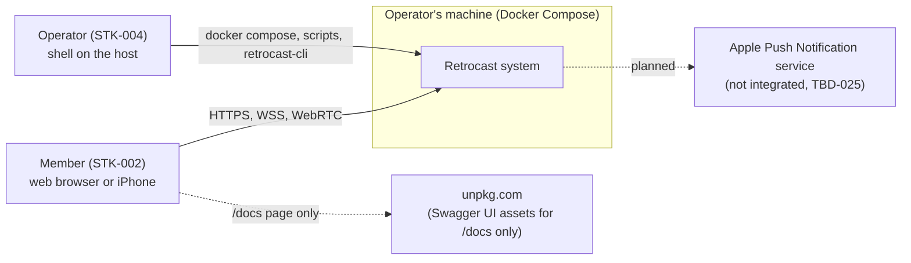
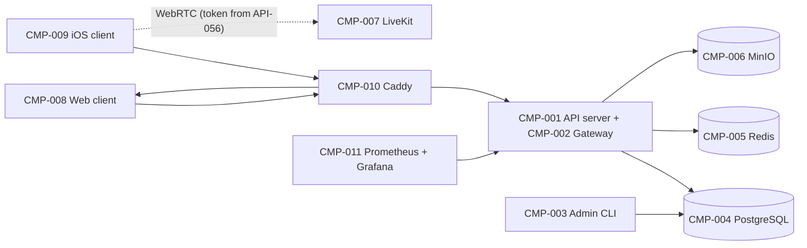
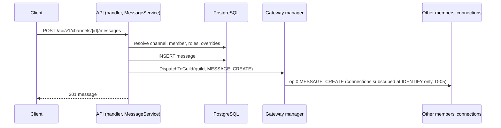
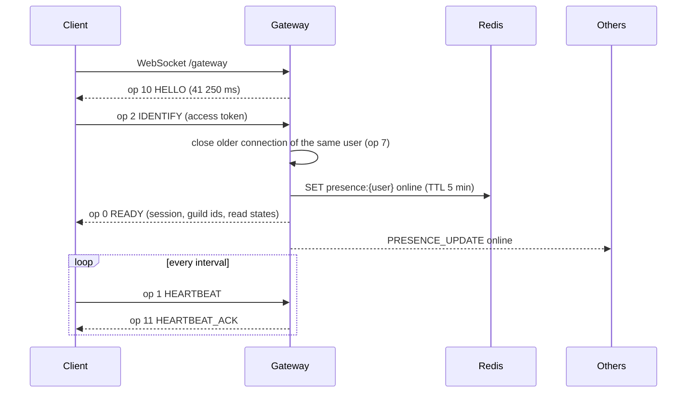

# Retrocast — Architecture

Status: Draft (spec INIT, unattended; for owner review)
Related: [SRS](SRS.md) · [Data Contracts](DATA_CONTRACTS.md) · [Product Brief](PRODUCT_BRIEF.md)

> This file is the spec-format architecture document. It is named `ARCHITECTURE_SPEC.md`
> because the older prose file `docs/architecture.md` would collide with `ARCHITECTURE.md` on
> case-insensitive file systems (TBD-034).

It describes the system as built at commit `6bc385e`. Design intent comes from
`SYSTEM_DESIGN.md`; where the code differs, the code is described and the difference noted.

## 1. Introduction and goals
- Goals: GOAL-001 (5–20 people chatting in real time on one self-hosted machine), GOAL-002
  (persistent voice rooms), GOAL-003 (early-Discord scope), GOAL-004 (data stays local).
- Quality priorities, in the order the seed implies: data stays local (SYS-NFR-003), correct
  authorisation (SV-FR-045), real-time delivery (SV-FR-026, SYS-NFR-002), simple operation on
  one host (SYS-CON-001). Numeric targets are TBD-031.
- Stakeholders: STK-001 owner, STK-002 member, STK-003 server owner or admin, STK-004
  operator, STK-005 App Store review (PRODUCT_BRIEF §3).

## 2. Constraints
SYS-CON-001 (one host, Docker Compose), SYS-CON-002 (no third-party account or email),
SYS-CON-003 (existing stack), SYS-CON-004 (licence, TBD-007).

## 3. System context (C4 level 1)

No core flow leaves the host (SYS-NFR-003). The `/docs` page is the one place a browser loads
an outside asset.

## 4. Solution strategy
- One Go process serves REST and the WebSocket gateway, so a request can dispatch an event
  in memory with no broker (ADR-001).
- PostgreSQL holds durable data; Redis holds short-lived state; MinIO holds files (ADR-002–
  ADR-004).
- LiveKit carries voice; the Go server only issues room tokens (ADR-005).
- Clients are thin: React in the browser and SwiftUI on iOS, both on the same REST and
  gateway contracts (PRN-003, ADR-008).
- Caddy terminates TLS in front of everything (ADR-010).

### 4.1 Stack decision
Recorded at major-version level from the Stack Profile (generated locally, not committed).
PR #23 (open) moves the Go toolchain to 1.26 and refreshes dependencies within the same major
versions.

| Tier | Choice | Version | Evidence |
|---|---|---|---|
| Server language | Go | 1.x (go.mod `go 1.25.7`; CI and Dockerfile 1.25; PR #23: 1.26) | retrocast/go.mod; .github/workflows/ci.yml; retrocast/Dockerfile |
| HTTP framework | Echo | v4 | retrocast/go.mod |
| PostgreSQL driver | pgx | v5 | retrocast/go.mod |
| Redis client | go-redis | v9 | retrocast/go.mod |
| WebSocket | gorilla/websocket | v1 | retrocast/go.mod |
| Tokens | golang-jwt | v5 | retrocast/go.mod |
| Password hashing | golang.org/x/crypto argon2 | v0 | retrocast/go.mod |
| Migrations | golang-migrate | v4 | retrocast/go.mod |
| Object store client | minio-go | v7 | retrocast/go.mod |
| Database | PostgreSQL | 17 | retrocast/docker-compose.yml; CI service |
| Cache and ephemeral state | Redis | 7 | retrocast/docker-compose.yml; CI service |
| Object store | MinIO | unpinned (`latest`) | retrocast/docker-compose.yml |
| Voice | LiveKit server | unpinned (`latest`) | retrocast/docker-compose.yml |
| Edge | Caddy | 2 | retrocast/docker-compose.yml; retrocast/Caddyfile |
| Web client | React, React Router, Zustand, Tailwind CSS, react-markdown | 19, 7, 5, 4, 10 | retrocast-web/package.json |
| Web build | Vite, TypeScript, ESLint, pnpm, Node | 7, 5, 9, 10, 22 | retrocast-web/package.json; retrocast-web/Dockerfile |
| Web serving | nginx | unpinned (`alpine`) | retrocast-web/Dockerfile |
| iOS client | Swift, SwiftUI, XcodeGen | Swift 6; iOS 17 target | retrocast-client/Retrocast/project.yml |
| Monitoring | Prometheus, Grafana | unpinned (`latest`) | retrocast/docker-compose.yml |
| CI | GitHub Actions; golangci-lint | v2 | .github/workflows/ci.yml |

PR #22 (open) proposes a Rust core for permission resolution; it is not part of this stack
(ADR-009, TBD-008).

## 5. Components (C4 level 2)

| ID | Component | Technology | Responsibility | Code | Requirements |
|---|---|---|---|---|---|
| CMP-001 | API server | Go, Echo | REST `/api/v1`: handlers, services (business rules, permissions), repositories; `/health`, `/metrics`, `/docs` | retrocast/cmd/retrocast; internal/api, internal/service, internal/database, internal/auth, internal/permissions | SV-FR-001–SV-FR-059, SV-IR-001, SV-IR-003–SV-IR-006, SV-NFR-001–SV-NFR-007 |
| CMP-002 | Gateway | Go, gorilla/websocket (same binary as CMP-001) | Sessions, heartbeats, presence, event fan-out, replay buffer | retrocast/internal/gateway | SV-FR-026, SV-FR-031–SV-FR-039, SV-IR-002 |
| CMP-003 | Admin CLI | Go | `migrate`, `seed`, `health`, `version` | retrocast/cmd/retrocast-cli | TBD-040 |
| CMP-004 | PostgreSQL | PostgreSQL 17 | Durable entities ENT-001–ENT-018; full-text search | retrocast/migrations | SV-NFR-007, SV-FR-059 |
| CMP-005 | Redis | Redis 7 | ENT-019–ENT-021 | retrocast/internal/redis | SV-FR-005, SV-FR-032–SV-FR-034, SV-NFR-003 |
| CMP-006 | MinIO | MinIO | ENT-022 attachments | retrocast/internal/storage | SV-FR-051, SV-FR-052 |
| CMP-007 | LiveKit | LiveKit server | Voice rooms (WebRTC SFU) | retrocast/internal/service/voice.go (token minting only) | SV-FR-048, SV-IR-006 |
| CMP-008 | Web client | React SPA on nginx | Browser UI; nginx proxies `/api` and `/gateway` | retrocast-web | WEB-FR-001–WEB-FR-018 |
| CMP-009 | iOS client | SwiftUI | iPhone UI | retrocast-client | IOS-FR-001–IOS-FR-012 |
| CMP-010 | Edge proxy | Caddy 2 | TLS; routes `/api/*`, `/gateway`, `/health` to CMP-001 and the rest to CMP-008 | retrocast/Caddyfile | SV-NFR-008 |
| CMP-011 | Monitoring | Prometheus, Grafana | Scrapes `api:8080/metrics`; dashboards | retrocast/prometheus.yml; retrocast/grafana | TBD-039 |

Inside CMP-001, requests pass handler → service → repository. Services own validation and
permission checks (`internal/service/permission.go`) and call the gateway manager to dispatch
events. `internal/api/permission_middleware.go` exists but no route uses it.
`docs/architecture.md` predates the service layer.

### 5.1 Runtime views

Sending a message (SV-FR-025, SV-FR-026):

Connecting (SV-FR-035–SV-FR-039):

Joining voice (SV-FR-048): the client calls API-056; the server checks `CONNECT`, writes a
voice state, mints a LiveKit token for room `voice-{channel id}` and dispatches
VOICE_STATE_UPDATE. The client must already know the LiveKit URL. The iOS client requests the
token but has no LiveKit SDK (IOS-FR-011).

Refreshing a session (SV-FR-005): the client posts the refresh token; the server reads
`refresh:{token}` from Redis, deletes it, and issues a new pair.

## 6. Deployment view
- One host runs `retrocast/docker-compose.yml`: api, db, redis, minio, livekit, web, caddy,
  prometheus, grafana. Volumes: pgdata, minio-data, redis-data, caddy_data, prometheus-data,
  grafana-data.
- Published ports: Caddy 80 and 443 (clients); api 8080 (plain HTTP, includes `/metrics`);
  MinIO 9000 and its console 9001; LiveKit 7880, 7881 and UDP 50000–50100; Prometheus 9090;
  Grafana 3000. PostgreSQL and Redis are not published. Only Caddy and LiveKit are meant for
  clients (SV-NFR-008, TBD-016).
- CI (`.github/workflows/ci.yml`) builds and pushes the api and web images to GHCR on `main`.
  No deploy job exists. Hosting beyond the operator's machine is TBD-002; a public demo is
  TBD-005.
- Backups: `retrocast/scripts/backup.sh` and `restore.sh` (PostgreSQL dump and MinIO
  archive), run by hand (SYS-NFR-005).

## 7. Cross-cutting concepts

### 7.1 Authentication
Username and password; Argon2id hashes (SV-NFR-001); HS256 access token for 15 minutes and
an opaque refresh token in Redis for 7 days with rotation (SV-NFR-002). The gateway accepts the
access token in IDENTIFY and RESUME.

### 7.2 Authorisation
Permission bitfields on roles and per-channel allow and deny overrides
(DATA_CONTRACTS §3.1). Owner and Administrator bypass every check (SV-FR-046). Channel checks
follow docs/permissions.md; guild-level checks and role management have the gaps D-01–D-04.
Resolution is in Go (ADR-009).

### 7.3 Real-time delivery
In-process fan-out from services to gateway connections, keyed by the guilds a connection
subscribed to at IDENTIFY. Per-connection send buffer of 256 frames. A 100-event replay
buffer per guild backs RESUME (D-07).

### 7.4 Configuration and secrets
Environment variables override the optional TOML file (DATA_CONTRACTS §1). Secrets live in
`retrocast/.env`, which is not committed; `.env.example` and `retrocast.toml.example` hold
development defaults. `JWT_SECRET` has no minimum length check.

### 7.5 Observability
JSON request logs through slog (SV-NFR-006); `/health` checks PostgreSQL and Redis
(SV-NFR-005); Prometheus metrics at `/metrics` with Grafana provisioning (TBD-039).

### 7.6 Error handling
One JSON error envelope with stable codes (DATA_CONTRACTS §5), except for the JWT middleware
and the typing handler (SV-IR-003).

### 7.7 Identifiers
Snowflake ids generated in-process (`internal/snowflake`), serialised as strings
(SV-IR-004), with two exceptions (D-11).

## 8. Architecture decisions

Each ADR records a decision already present in the code. Status `Accepted` means "in the
code"; none has been reviewed by the owner in this spec.

| ID | Decision | Context and alternatives | Status | Consequences | Source |
|---|---|---|---|---|---|
| ADR-001 | One Go binary serves REST and the WebSocket gateway | Separate gateway service or a broker; at 5–20 users one process suffices | Accepted | No horizontal scaling; events dispatch in memory | SYSTEM_DESIGN.md:121–150; retrocast/cmd/retrocast |
| ADR-002 | PostgreSQL is the only durable store, including full-text search | Separate search engine | Accepted | Search uses English stemming (TBD-023) | SYSTEM_DESIGN.md:132–140; migrations/000015 |
| ADR-003 | Redis holds refresh tokens, presence, typing and rate-limit counters | Keep them in PostgreSQL or memory | Accepted | Losing Redis signs everyone out; unused `refresh_tokens` table remains | internal/redis/client.go |
| ADR-004 | MinIO stores attachments | Local disk | Accepted | URLs need a public path (D-10) | SYSTEM_DESIGN.md:192; internal/storage |
| ADR-005 | LiveKit carries voice; the server only mints tokens without an SDK | Pion directly | Accepted | No webhooks, so voice state can go stale | SYSTEM_DESIGN.md:152–161; internal/service/voice.go |
| ADR-006 | Snowflake ids, JSON strings | UUIDs; database sequences | Accepted | Time-ordered ids give cursor paging | SYSTEM_DESIGN.md:543; internal/snowflake |
| ADR-007 | Short JWT access token plus rotating opaque refresh token; Argon2id | Sessions in cookies | Accepted | Clients must store the rotated token (D-15) | SYSTEM_DESIGN.md:230; internal/auth |
| ADR-008 | The web client is React with Vite, not the SvelteKit app SYSTEM_DESIGN recommends | SvelteKit (SYSTEM_DESIGN.md:173–181); Tauri desktop wrapping it (CAP-029) | Accepted | The Tauri plan assumed SvelteKit and needs a new decision (TBD-028) | retrocast-web/package.json |
| ADR-009 | Permission resolution stays in Go (`internal/permissions`, `internal/service/permission.go`) | PR #22 proposes a required Rust core | Accepted (alternative open, TBD-008) | Adopting PR #22 changes the build, CI and contributor toolchain | internal/permissions; PR #22 |
| ADR-010 | Caddy terminates TLS; nginx serves the web build | Expose the API directly | Accepted | Compose also publishes 8080 and 9000 in plain HTTP (TBD-016) | retrocast/Caddyfile; retrocast-web/nginx.conf |
| ADR-011 | Single-host Docker Compose deployment | Kubernetes; managed cloud | Accepted | No high availability (SYS-CON-001) | SYSTEM_DESIGN.md:196; retrocast/docker-compose.yml |
| ADR-012 | Handlers call services, services call repositories behind interfaces | Handlers calling the database | Accepted | Handler tests run on mock repositories; `internal/service` has no tests of its own | retrocast/internal |

## 9. Risks and technical debt

Brief risks RISK-001–RISK-012 are in PRODUCT_BRIEF §11. The defects below were found by
reading the code; D-08 and D-09 were also reproduced on PostgreSQL 17 with all migrations
applied. "Pilot" marks a defect that blocks a Pilot requirement (SRS §1.8).

| ID | Defect | Evidence (file:line) | Affects | Blocks |
|---|---|---|---|---|
| D-01 | Role and override management checks no `MANAGE_ROLES`; the hierarchy check allows negative positions, so a member with no roles can create an Administrator role at position -1 and assign it to themself | retrocast/internal/service/role.go:48–82, :180–245, :248–277; permission.go:208–219 | SV-FR-040–SV-FR-043, SV-FR-047 | Pilot |
| D-02 | Update and delete do not check that the role belongs to the guild in the path; a new position is not checked against the caller's highest role | retrocast/internal/service/role.go:97–142, :145–177 | SV-FR-041, SV-FR-042 | Pilot |
| D-03 | Listing roles checks no membership | retrocast/internal/service/role.go:85–94 | SV-FR-044 | Pilot |
| D-04 | Guild-level checks combine only assigned roles, and invite joiners get no `@everyone` row, so `@everyone` guild permissions do not apply to them | retrocast/internal/service/permission.go:36–76; invite.go:173–181 | SV-FR-045, SV-FR-020 | Pilot |
| D-05 | `SubscribeToGuild` and `UnsubscribeFromGuild` have no callers: members who create or join a guild after connecting get no events, and removed members keep receiving them | retrocast/internal/gateway/manager.go:130–140 | SV-FR-026, SV-FR-020 | Pilot |
| D-06 | Event fan-out and search ignore channel `VIEW_CHANNEL` overrides | retrocast/internal/gateway/manager.go:159; internal/service/search.go:33 | SV-FR-026, SV-FR-059, SV-FR-016 | Pilot |
| D-07 | RESUME replays a per-guild buffer using the client's per-connection sequence, does not check the session id, and sends no RECONNECT when events were lost | retrocast/internal/gateway/manager.go:287–336, :395–458 | SV-FR-038 | Pilot |
| D-08 | DM messages violate `messages_channel_id_fkey` (DM channels are not in `channels`) | retrocast/migrations/000007_create_messages.up.sql; 000014_create_dm_channels.up.sql | SV-FR-055, WEB-FR-016, IOS-FR-009 | Later |
| D-09 | Upload inserts the attachment with `message_id` 0, violating `attachments_message_id_fkey`; no API links an attachment to a message | retrocast/internal/service/upload.go:92 | SV-FR-051, WEB-FR-017 | Later |
| D-10 | Attachment URLs use the compose-internal MinIO address over `http://` | retrocast/internal/storage/minio.go:56–58 | SV-FR-052, SV-NFR-008 | Later |
| D-11 | `Member.roles` and READY `guilds` serialise ids as JSON numbers; JavaScript loses precision above 2^53 | retrocast/internal/models/member.go:10; internal/gateway/events.go:78 | SV-IR-004 | Pilot |
| D-12 | Guild creation runs eight writes without a transaction | retrocast/internal/service/guild.go:47–128 | SV-FR-007 | — |
| D-13 | Unauthenticated rate-limit buckets use `c.RealIP()`, which trusts client-sent forwarding headers without a configured extractor; Redis errors let requests through; the invite lookup has no limit | retrocast/internal/api/ratelimit.go:20–22; router.go:105, :117 | SV-NFR-003 | Pilot |
| D-14 | Clients and server disagree on the response envelope: the web client always reads `json.data`; the iOS refresh path accepts only the wrapped form | retrocast-web/src/lib/api.ts:113; retrocast-client/Retrocast/Sources/Networking/APIClient.swift:211 | WEB-FR-002, WEB-FR-003, WEB-FR-005, WEB-FR-007, WEB-FR-012, WEB-FR-013, IOS-FR-002 | Pilot |
| D-15 | The web client keeps the old refresh token after rotation | retrocast-web/src/stores/auth.ts:83–93 | WEB-FR-003 | Pilot |
| D-16 | The web client revokes invites at `/invites/{code}` without `/api/v1` | retrocast-web/src/components/InviteModal.tsx:42 | WEB-FR-012 | Pilot |
| D-17 | CORS allows every origin and the gateway accepts every origin | retrocast/cmd/retrocast/main.go:182–183; internal/gateway/server.go:14 | SV-NFR-008 | Pilot |
| D-18 | The typing route checks no membership or permission and returns 404 for DM channels; `MessageService.Typing` has no route | retrocast/internal/gateway/typing.go:30–59; internal/api/router.go:194; internal/service/message.go:225 | SV-FR-031 | Pilot |
| D-19 | READY has no presence snapshot, and heartbeats do not extend the 5-minute presence TTL | retrocast/internal/gateway/events.go:75–80; internal/redis/client.go:48 | SV-FR-032 | Pilot |
| D-20 | Invite `uses` is checked and incremented without a lock, so concurrent accepts can pass `max_uses` | retrocast/internal/service/invite.go:153, :183 | SV-FR-020 | — |
| D-21 | Refresh rotation reads then deletes the token in two commands, so two concurrent refreshes can both succeed | retrocast/internal/redis/client.go:58, :75 | SV-FR-005 | — |
| D-22 | Any `image/*` type is accepted, including SVG, which can carry script when opened directly | retrocast/internal/service/upload.go:107–115 | SV-FR-051 | — |
| D-23 | LiveKit tokens last 24 hours and do not reflect `SPEAK`; no webhook clears stale voice states | retrocast/internal/service/voice.go:178–197 | SV-FR-048, SV-FR-049 | — |
| D-24 | Users cannot be deleted while they own a guild or have messages (foreign keys without ON DELETE) | retrocast/migrations/000002_create_guilds.up.sql; 000007_create_messages.up.sql | TBD-022 | — |

Other debt: the `refresh_tokens` and `device_tokens` tables have no code; op 4 is defined
but unhandled; username uniqueness is case-sensitive; invite codes carry 32 random bits; the
Go version differs between go.mod, CI, Dockerfile and README; compose images for MinIO,
LiveKit, Prometheus and Grafana are unpinned; CI installs `migrate@latest`; no formatter gate;
no web test runner; no iOS build in CI. Documentation drift: `docs/architecture.md`
(no service layer), `docs/database.md` (14 migrations), `docs/permissions.md` (default
permissions), `docs/api.md` (register status and envelope), README ("Go 1.25+",
"retrocast-client (planned)"), `retrocast-web/README.md` (Vite template), TODO.md ("Vite 6").

## 10. Glossary
See [SRS §1.3](SRS.md) and §5.3.

## Revision history
| Rev | Date | Commit | Mode | Summary |
|---|---|---|---|---|
