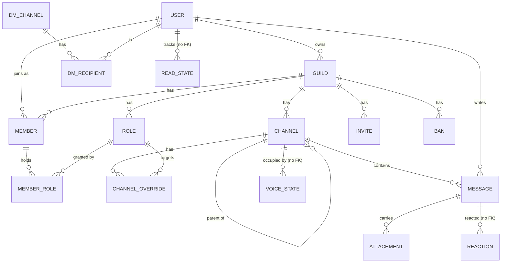

# Retrocast — Data Contracts

Status: Draft (spec INIT, unattended; for owner review)
Related: [SRS](SRS.md) · [Architecture](ARCHITECTURE_SPEC.md) · [Product Brief](PRODUCT_BRIEF.md)

This document records the data and interface contracts as they exist at commit `6bc385e`.
Sources: `retrocast/migrations/000001–000019`, `retrocast/internal/models/`,
`retrocast/internal/gateway/events.go`, `retrocast/internal/redis/client.go`,
`retrocast/docs/openapi.yaml` (OpenAPI 3.0.3, `info.version` 1.0.0, 58 operations).
Every contract below is version `v1.0.0`: the code has no versioning beyond the `/api/v1`
prefix, and nothing has been released (TBD-003).

## 1. Configuration contract
The server reads configuration from environment variables, which override an optional TOML
file (`$RETROCAST_CONFIG`, then `./retrocast.toml`, then `/etc/retrocast/config.toml`;
`retrocast/internal/config/config.go`).

| Key | Required | Purpose |
|---|---|---|
| `DATABASE_URL` | yes | PostgreSQL connection string |
| `JWT_SECRET` | yes | HMAC key for access tokens (no minimum length is enforced) |
| `REDIS_URL` | no | Redis connection |
| `SERVER_ADDR` | no | Listen address (compose publishes 8080) |
| `LOG_LEVEL` | no | slog level |
| `MINIO_ENDPOINT`, `MINIO_ACCESS_KEY`, `MINIO_SECRET_KEY` | yes for uploads | Object store; bucket `retrocast` is created at start |
| `LIVEKIT_URL`, `LIVEKIT_API_KEY`, `LIVEKIT_API_SECRET` | yes for voice | Token minting (§7.1) |
| `POSTGRES_PASSWORD`, `MINIO_ROOT_PASSWORD` | compose only | Service passwords used by `docker-compose.yml` |
| `DOMAIN` | Caddy only | Site address in `retrocast/Caddyfile` (default `localhost`) |

Values come from `retrocast/.env` (template `retrocast/.env.example`). The example files hold
development defaults; they are not repeated here.

## 2. Conceptual model

`messages.channel_id` references `channels` only, so a message cannot belong to a DM channel
(D-08). `attachments.message_id` is required, so an attachment cannot exist before its
message (D-09).

## 3. Entities

All ids are 64-bit snowflakes (`retrocast/internal/snowflake`) encoded in JSON as decimal
strings, except where noted (SV-IR-004, D-11).

| ID | Entity | Store | Fields (constraints) | Integrity | Classification | Requirements | Version |
|---|---|---|---|---|---|---|---|
| ENT-001 | User | PostgreSQL `users` | id PK; username VARCHAR(32) unique (case-sensitive); display_name VARCHAR(32); avatar_hash VARCHAR(64) null; password_hash TEXT (never serialised); created_at | Referenced by guilds.owner_id, messages.author_id, invites.creator_id and bans.created_by without ON DELETE, so a user who owns a guild or wrote a message cannot be deleted (TBD-022) | Personal (username, display name); Secret (password hash) | SV-FR-001–SV-FR-004, SV-FR-053, SV-NFR-001 | v1.0.0 |
| ENT-002 | Guild | PostgreSQL `guilds` | id PK; name VARCHAR(100) (2–100 in service); icon_hash VARCHAR(64) null; owner_id FK users; created_at | Deleting a guild cascades to channels, roles, members, invites and bans | Internal | SV-FR-007–SV-FR-013 | v1.0.0 |
| ENT-003 | Channel | PostgreSQL `channels` | id PK; guild_id FK cascade; name VARCHAR(100); type SMALLINT (0 text, 2 voice, 4 category); position INT; topic VARCHAR(1024) null; parent_id FK channels null | UNIQUE(guild_id, name); parent_id has no ON DELETE | Internal | SV-FR-009, SV-FR-014–SV-FR-017 | v1.0.0 |
| ENT-004 | Member | PostgreSQL `members` | PK (guild_id, user_id), both FK cascade; nickname VARCHAR(32) null; joined_at; JSON adds `roles` (role ids as JSON numbers, D-11) | Cascades to member_roles | Personal (nickname) | SV-FR-020, SV-FR-022–SV-FR-024 | v1.0.0 |
| ENT-005 | MemberRole | PostgreSQL `member_roles` | PK (guild_id, user_id, role_id); role_id FK roles cascade; (guild_id, user_id) FK members cascade | No check that the role belongs to the same guild at the database level | Internal | SV-FR-008, SV-FR-043, SV-FR-045 | v1.0.0 |
| ENT-006 | Role | PostgreSQL `roles` | id PK; guild_id FK cascade; name VARCHAR(100); color INT; permissions BIGINT bitfield (§3.1); position INT; is_default BOOL (`@everyone`) | — | Internal | SV-FR-008, SV-FR-040–SV-FR-046 | v1.0.0 |
| ENT-007 | ChannelOverride | PostgreSQL `channel_overrides` | PK (channel_id, role_id), both FK cascade; allow_perms BIGINT; deny_perms BIGINT | No check that the role and channel share a guild | Internal | SV-FR-045, SV-FR-047 | v1.0.0 |
| ENT-008 | Message | PostgreSQL `messages` | id PK; channel_id FK channels cascade; author_id FK users; content TEXT (1–2000 bytes in service); created_at; edited_at null; search_vector tsvector (English, trigger-maintained, GIN index) | Index (channel_id, id DESC) for paging | Personal (content) | SV-FR-025–SV-FR-030, SV-FR-055, SV-FR-059 | v1.0.0 |
| ENT-009 | Attachment | PostgreSQL `attachments` | id PK; message_id FK messages cascade, NOT NULL; filename VARCHAR(256); content_type VARCHAR(128); size BIGINT; storage_key TEXT (never serialised); JSON adds `url` | Upload writes message_id 0, which the FK rejects (D-09) | Personal (file content) | SV-FR-051, SV-FR-052 | v1.0.0 |
| ENT-010 | Invite | PostgreSQL `invites` | code VARCHAR(8) PK (8 hex characters, 32 random bits); guild_id FK cascade; channel_id FK channels null; creator_id FK users; max_uses INT (0 unlimited); uses INT; expires_at null; created_at | `uses` is incremented without a lock against `max_uses` | Internal | SV-FR-018–SV-FR-021 | v1.0.0 |
| ENT-011 | Ban | PostgreSQL `bans` | PK (guild_id, user_id); reason TEXT null; created_by FK users; created_at | — | Personal (reason) | TBD-035 | v1.0.0 |
| ENT-012 | DMChannel | PostgreSQL `dm_channels` | id PK; type INT (1 DM, 3 group DM); created_at; owner_id BIGINT null (migration 000019, no FK) | Not referenced by messages (D-08) | Internal | SV-FR-054–SV-FR-058 | v1.0.0 |
| ENT-013 | DMRecipient | PostgreSQL `dm_recipients` | PK (channel_id, user_id), both FK cascade | At most 10 participants per group DM (service) | Internal | SV-FR-054, SV-FR-056, SV-FR-057 | v1.0.0 |
| ENT-014 | Reaction | PostgreSQL `reactions` | PK (message_id, user_id, emoji); created_at | No foreign keys: rows outlive deleted messages and users | Personal | TBD-036 | v1.0.0 |
| ENT-015 | ReadState | PostgreSQL `read_states` | PK (user_id, channel_id); last_message_id BIGINT default 0; mention_count INT; updated_at | No foreign keys | Personal | TBD-037 | v1.0.0 |
| ENT-016 | VoiceState | PostgreSQL `voice_states` | PK (guild_id, user_id); channel_id; session_id TEXT; self_mute BOOL; self_deaf BOOL; joined_at | No foreign keys; rows stay when a client disconnects without leaving | Personal (presence in a room) | SV-FR-048–SV-FR-050 | v1.0.0 |
| ENT-017 | DeviceToken | PostgreSQL `device_tokens` | id BIGSERIAL PK; user_id FK cascade; platform VARCHAR(16); token TEXT; UNIQUE(user_id, token) | No code reads or writes it | Secret (push token) | TBD-025 | v1.0.0 |
| ENT-018 | RefreshTokenRow | PostgreSQL `refresh_tokens` | token VARCHAR(64) PK; user_id FK cascade; expires_at; created_at | No code reads or writes it; refresh tokens live in Redis (ENT-019) | Secret | none | v1.0.0 |
| ENT-019 | RefreshToken | Redis | key `refresh:{token}` (token = 32 random bytes, hex); value user id; TTL 7 days | Read then deleted on refresh (two commands, not atomic) | Secret | SV-FR-005, SV-FR-006, SV-NFR-002 | v1.0.0 |
| ENT-020 | Presence | Redis | key `presence:{user id}`; value status; TTL 5 minutes | Set on IDENTIFY and op 3; heartbeats do not extend the TTL | Personal | SV-FR-032–SV-FR-034 | v1.0.0 |
| ENT-021 | RateLimitCounter and TypingMarker | Redis | `rl:user:{user id}:{route}` or `rl:ip:{client ip}:{route}`, one-minute window (Lua script); `typing:{channel id}:{user id}`, TTL 10 s | Ephemeral | Internal | SV-NFR-003, SV-FR-031 | v1.0.0 |
| ENT-022 | StoredObject | MinIO bucket `retrocast` | key `attachments/{channel id}/{attachment id}/{filename}`; content type from upload | Objects remain when the attachment row insert fails (D-09) | Personal (file content) | SV-FR-051, SV-FR-052 | v1.0.0 |

### 3.1 Permission bits (ENT-006, ENT-007)
Source: `retrocast/internal/permissions/bitfield.go`.

| Bit | Name | Bit | Name |
|---|---|---|---|
| 0 | VIEW_CHANNEL | 10 | MUTE_MEMBERS |
| 1 | SEND_MESSAGES | 11 | DEAFEN_MEMBERS |
| 2 | MANAGE_MESSAGES | 12 | MOVE_MEMBERS |
| 3 | MANAGE_CHANNELS | 13 | MENTION_EVERYONE |
| 4 | MANAGE_ROLES | 14 | ATTACH_FILES |
| 5 | KICK_MEMBERS | 15 | READ_MESSAGE_HISTORY |
| 6 | BAN_MEMBERS | 16 | CREATE_INVITE |
| 7 | MANAGE_GUILD | 17 | CHANGE_NICKNAME |
| 8 | CONNECT | 18 | MANAGE_NICKNAMES |
| 9 | SPEAK | 31 | ADMINISTRATOR (bypasses every check) |

`DefaultEveryonePerms` (bitfield.go:46) is VIEW_CHANNEL, SEND_MESSAGES, READ_MESSAGE_HISTORY,
CONNECT, SPEAK, CREATE_INVITE and CHANGE_NICKNAME. Guild creation gives `@everyone` only the
first three (`internal/service/guild.go:64–72`). The intended default is TBD-014.

## 4. REST operations

Base path `/api/v1`; JSON bodies; `Authorization: Bearer <access token>` on every operation
except API-001–API-003 and API-049. "Wrapped" responses are `{"data": …}`; the others are the
bare object (TBD-010). Status codes are as documented in OpenAPI; where the code differs, the
Notes column says so. Every operation is version v1.0.0.

| ID | Operation | Method and path | Success | Wrapped | Notes | Requirements |
|---|---|---|---|---|---|---|
| API-001 | register | POST /auth/register | 200 tokens + user | no | docs/api.md says 201 | SV-FR-001–SV-FR-003, SYS-CON-002 |
| API-002 | login | POST /auth/login | 200 tokens + user | no | | SV-FR-004 |
| API-003 | refreshToken | POST /auth/refresh | 200 token pair | no | | SV-FR-005 |
| API-004 | logout | POST /auth/logout | 204 | — | | SV-FR-006 |
| API-005 | getMe | GET /users/@me | 200 user | yes | | SV-FR-053 |
| API-006 | updateMe | PATCH /users/@me | 200 user | yes | | SV-FR-053 |
| API-007 | listMyGuilds | GET /users/@me/guilds | 200 guilds | yes | | SV-FR-013 |
| API-008 | createDM | POST /users/@me/channels | 200 DM channel | no | `recipient_id` (DM) or `recipient_ids` (group) | SV-FR-054, SV-FR-056 |
| API-009 | listDMs | GET /users/@me/channels | 200 DM channels | no | | SV-FR-058 |
| API-010 | addGroupDMMember | PUT /channels/{channelId}/recipients/{userId} | 204 | — | | SV-FR-057 |
| API-011 | removeGroupDMMember | DELETE /channels/{channelId}/recipients/{userId} | 204 | — | | SV-FR-057 |
| API-012 | getReadStates | GET /users/@me/read-states | 200 read states | no | | TBD-037 |
| API-013 | createGuild | POST /guilds | 201 guild | yes | | SV-FR-007–SV-FR-009 |
| API-014 | getGuild | GET /guilds/{guildId} | 200 guild | yes | | SV-FR-010 |
| API-015 | updateGuild | PATCH /guilds/{guildId} | 200 guild | yes | | SV-FR-011 |
| API-016 | deleteGuild | DELETE /guilds/{guildId} | 204 | — | | SV-FR-012 |
| API-017 | createChannel | POST /guilds/{guildId}/channels | 201 channel | yes | | SV-FR-014, SV-FR-017 |
| API-018 | listChannels | GET /guilds/{guildId}/channels | 200 channels | yes | | SV-FR-009, SV-FR-016 |
| API-019 | getChannel | GET /channels/{channelId} | 200 channel | yes | | SV-FR-016 |
| API-020 | updateChannel | PATCH /channels/{channelId} | 200 channel | yes | | SV-FR-015 |
| API-021 | deleteChannel | DELETE /channels/{channelId} | 204 | — | | SV-FR-015 |
| API-022 | sendMessage | POST /channels/{channelId}/messages | 201 message | no | DM channels fail (D-08) | SV-FR-025, SV-FR-055 |
| API-023 | getMessages | GET /channels/{channelId}/messages | 200 messages | no | `limit` 1–100 (50), `before` | SV-FR-027, SV-FR-052 |
| API-024 | getMessage | GET /channels/{channelId}/messages/{messageId} | 200 message | no | | SV-FR-028 |
| API-025 | editMessage | PATCH /channels/{channelId}/messages/{messageId} | 200 message | no | | SV-FR-029 |
| API-026 | deleteMessage | DELETE /channels/{channelId}/messages/{messageId} | 204 | — | | SV-FR-030 |
| API-027 | uploadAttachment | POST /channels/{channelId}/attachments | 201 attachment | no | multipart; ≤10 MB; JPEG, PNG, GIF, WebP, PDF, plain text, and any `image/*` type (SVG included) | SV-FR-051 |
| API-028 | triggerTyping | POST /channels/{channelId}/typing | 204 | — | routed to `gateway.TypingHandler`, not the service | SV-FR-031 |
| API-029 | ackMessage | PUT /channels/{channelId}/ack/{messageId} | 204 | — | | TBD-037 |
| API-030 | addReaction | PUT /channels/{channelId}/messages/{messageId}/reactions/{emoji}/@me | 204 | — | | TBD-036 |
| API-031 | removeReaction | DELETE /channels/{channelId}/messages/{messageId}/reactions/{emoji}/@me | 204 | — | | TBD-036 |
| API-032 | getReactions | GET /channels/{channelId}/messages/{messageId}/reactions/{emoji} | 200 users | no | | TBD-036 |
| API-033 | listMembers | GET /guilds/{guildId}/members | 200 members | yes | `limit` 1–100 (50), `offset` | SV-FR-023 |
| API-034 | updateSelf | PATCH /guilds/{guildId}/members/@me | 200 member | yes | nickname | TBD-038 |
| API-035 | leaveGuild | DELETE /guilds/{guildId}/members/@me | 204 | — | owner gets 403 | SV-FR-022 |
| API-036 | getMember | GET /guilds/{guildId}/members/{userId} | 200 member | yes | | SV-FR-024 |
| API-037 | updateMember | PATCH /guilds/{guildId}/members/{userId} | 200 member | yes | nickname, roles | SV-FR-043, TBD-038 |
| API-038 | kickMember | DELETE /guilds/{guildId}/members/{userId} | 204 | — | | TBD-035 |
| API-039 | createRole | POST /guilds/{guildId}/roles | 201 role | no | | SV-FR-040 |
| API-040 | listRoles | GET /guilds/{guildId}/roles | 200 roles | no | no membership check (D-03) | SV-FR-044 |
| API-041 | updateRole | PATCH /guilds/{guildId}/roles/{roleId} | 200 role | no | | SV-FR-041 |
| API-042 | deleteRole | DELETE /guilds/{guildId}/roles/{roleId} | 204 | — | `@everyone` gives 403 `CANNOT_DELETE` | SV-FR-042 |
| API-043 | assignRole | PUT /guilds/{guildId}/members/{userId}/roles/{roleId} | 204 | — | | SV-FR-043 |
| API-044 | removeRole | DELETE /guilds/{guildId}/members/{userId}/roles/{roleId} | 204 | — | | SV-FR-043 |
| API-045 | setChannelOverride | PUT /channels/{channelId}/permissions/{roleId} | 200 override | no | no permission check (D-01) | SV-FR-047 |
| API-046 | deleteChannelOverride | DELETE /channels/{channelId}/permissions/{roleId} | 204 | — | no permission check (D-01) | SV-FR-047 |
| API-047 | createInvite | POST /guilds/{guildId}/invites | 201 invite | no | `max_age` default 86 400 s, `max_uses` default 0 | SV-FR-018 |
| API-048 | listInvites | GET /guilds/{guildId}/invites | 200 invites | no | | SV-FR-021 |
| API-049 | getInvite | GET /invites/{code} | 200 invite preview | no | public; expired gives 404 `EXPIRED` | SV-FR-019 |
| API-050 | acceptInvite | POST /invites/{code} | 200 guild | no | code also returns 410 and 403 `BANNED`, which OpenAPI omits | SV-FR-020 |
| API-051 | revokeInvite | DELETE /invites/{code} | 204 | — | | SV-FR-021 |
| API-052 | listBans | GET /guilds/{guildId}/bans | 200 bans | no | | TBD-035 |
| API-053 | banMember | PUT /guilds/{guildId}/bans/{userId} | 204 | — | | TBD-035 |
| API-054 | unbanMember | DELETE /guilds/{guildId}/bans/{userId} | 204 | — | | TBD-035 |
| API-055 | searchMessages | GET /guilds/{guildId}/messages/search | 200 messages | no | `q`, `author_id`, `before`, `after`, `limit` 1–100 (25) | SV-FR-059 |
| API-056 | joinVoice | POST /channels/{channelId}/voice/join | 200 token + voice states | no | no LiveKit URL in the response | SV-FR-048, SV-IR-006 |
| API-057 | leaveVoice | POST /channels/{channelId}/voice/leave | 204 | — | | SV-FR-049 |
| API-058 | getVoiceStates | GET /channels/{channelId}/voice/states | 200 voice states | no | | SV-FR-050 |

Routes outside `/api/v1`: `GET /health`, `GET /metrics` (Prometheus), `GET /docs`,
`GET /docs/openapi.yaml`, `GET /gateway` (WebSocket upgrade).

## 5. Error model
Handler errors use `{"error": {"code": "<CODE>", "message": "<text>"}}`
(`retrocast/internal/api/response.go`). Service error kinds map to statuses: not found 404,
forbidden 403, role hierarchy 403, bad request 400, conflict 409, unauthorized 401, gone 410,
anything else 500 `INTERNAL`. Rate limiting returns 429 `RATE_LIMITED` with `Retry-After`.
The JWT middleware and the typing handler return Echo's `{"message": …}` body instead
(SV-IR-003).

Codes in use: `INVALID_USERNAME`, `INVALID_PASSWORD`, `USERNAME_TAKEN`,
`INVALID_CREDENTIALS`, `MISSING_TOKEN`, `INVALID_TOKEN`, `INVALID_NAME`, `INVALID_TYPE`,
`INVALID_CONTENT`, `INVALID_CHANNEL`, `NOT_VOICE_CHANNEL`, `INVALID_DISPLAY_NAME`,
`INVALID_NICKNAME`, `INVALID_ROLE`, `INVALID_EMOJI`, `INVALID_QUERY`, `INVALID_RECIPIENT`,
`INVALID_RECIPIENTS`, `MAX_MEMBERS`, `FILE_TOO_LARGE`, `INVALID_CONTENT_TYPE`,
`CANNOT_BAN_SELF`, `CANNOT_DELETE`, `NOT_FOUND`, `EXPIRED`, `MAX_USES`, `ALREADY_MEMBER`,
`BANNED`, `FORBIDDEN`, `MISSING_PERMISSIONS`, `ROLE_HIERARCHY`, `RATE_LIMITED`, `INTERNAL`.

## 6. Gateway events

Endpoint `GET /gateway` (WebSocket). Every frame is `{"op": int, "d": any, "s": int, "t": string}`;
`s` and `t` are set on dispatches (op 0) only. Sequence numbers are per connection for live
dispatches and per guild in the replay buffer (D-07). Every event is version v1.0.0.

| ID | Op | Name | Direction | Payload `d` | Requirements |
|---|---|---|---|---|---|
| EVT-001 | 10 | HELLO | server → client | `heartbeat_interval` (41 250 ms) | SV-FR-035 |
| EVT-002 | 2 | IDENTIFY | client → server | `token` (access token) | SV-FR-036 |
| EVT-003 | 0 | READY | server → client | `session_id`, `user_id`, `guilds` (ids as JSON numbers, D-11), `read_states`; no presence list | SV-FR-036, SV-FR-032 |
| EVT-004 | 1 | HEARTBEAT | client → server | last sequence | SV-FR-037 |
| EVT-005 | 11 | HEARTBEAT_ACK | server → client | none | SV-FR-037 |
| EVT-006 | 6 | RESUME | client → server | `token`, `session_id`, `seq` | SV-FR-038 |
| EVT-007 | 7 | RECONNECT | server → client | none; sent to the older connection when a user identifies again | SV-FR-039 |
| EVT-008 | 3 | PRESENCE_UPDATE (client) | client → server | `status`: online, idle, dnd, invisible | SV-FR-033 |
| EVT-009 | 0 | MESSAGE_CREATE | server → client | message with author fields | SV-FR-026, SV-FR-055 |
| EVT-010 | 0 | MESSAGE_UPDATE | server → client | message | SV-FR-029 |
| EVT-011 | 0 | MESSAGE_DELETE | server → client | `id`, `channel_id` | SV-FR-030 |
| EVT-012 | 0 | GUILD_CREATE | server → client | guild (to the creator only) | SV-FR-007 |
| EVT-013 | 0 | GUILD_UPDATE | server → client | guild | SV-FR-011 |
| EVT-014 | 0 | GUILD_DELETE | server → client | `id` | SV-FR-012 |
| EVT-015 | 0 | CHANNEL_CREATE | server → client | channel (guild members) or DM channel (each recipient) | SV-FR-014, SV-FR-054 |
| EVT-016 | 0 | CHANNEL_UPDATE | server → client | channel | SV-FR-015 |
| EVT-017 | 0 | CHANNEL_DELETE | server → client | `id`, `guild_id` (guild channel) or DM channel | SV-FR-015 |
| EVT-018 | 0 | GUILD_MEMBER_ADD | server → client | member | SV-FR-020 |
| EVT-019 | 0 | GUILD_MEMBER_REMOVE | server → client | `guild_id`, `user_id` | SV-FR-022 |
| EVT-020 | 0 | GUILD_MEMBER_UPDATE | server → client | member | SV-FR-043 |
| EVT-021 | 0 | GUILD_ROLE_CREATE | server → client | `guild_id`, `role` | SV-FR-040 |
| EVT-022 | 0 | GUILD_ROLE_UPDATE | server → client | `guild_id`, `role` | SV-FR-041 |
| EVT-023 | 0 | GUILD_ROLE_DELETE | server → client | `guild_id`, `role_id` | SV-FR-042 |
| EVT-024 | 0 | TYPING_START | server → client | `channel_id`, `guild_id`, `user_id`, `timestamp` | SV-FR-031 |
| EVT-025 | 0 | PRESENCE_UPDATE | server → client | `user_id`, `status` (invisible shown as offline) | SV-FR-032–SV-FR-034 |
| EVT-026 | 0 | VOICE_STATE_UPDATE | server → client | voice state on join; `guild_id`, `channel_id` null, `user_id` on leave | SV-FR-048, SV-FR-049 |
| EVT-027 | 0 | GUILD_BAN_ADD | server → client | ban | TBD-035 |
| EVT-028 | 0 | GUILD_BAN_REMOVE | server → client | `guild_id`, `user_id` | TBD-035 |
| EVT-029 | 0 | MESSAGE_REACTION_ADD | server → client | reaction | TBD-036 |
| EVT-030 | 0 | MESSAGE_REACTION_REMOVE | server → client | reaction | TBD-036 |

Op 4 (`OpVoiceStateUpdate`) is defined in `events.go:15` but the server does not handle it.

## 7. External contracts

### 7.1 LiveKit
The server mints LiveKit access tokens itself (no SDK; `retrocast/internal/service/voice.go:178`):
HS256 signed with `LIVEKIT_API_SECRET`, `iss` = API key, `sub` = user id, name = username,
`exp` = 24 hours, grant `video.roomJoin` for room `voice-{channel id}`. The server does not
check `SPEAK` in the grant and receives no LiveKit webhooks, so voice state is only what
clients report (SV-FR-049). Clients need the LiveKit URL, which API-056 does not return.

### 7.2 MinIO (S3-compatible)
`retrocast/internal/storage/minio.go` uploads to bucket `retrocast` and builds URLs as
`http://{MINIO_ENDPOINT}/retrocast/{key}`. `MINIO_ENDPOINT` is an address inside the compose
network, so clients outside it cannot fetch those URLs (D-10, TBD-011).

### 7.3 Apple Push Notification service
Not integrated. `device_tokens` (ENT-017) exists without code (TBD-025).

## 8. Classification and retention
- Secret: password hashes, refresh tokens, device tokens, every value in `.env`.
- Personal: usernames, display names, nicknames, message content, attachments, presence,
  voice state, reactions, read states, ban reasons.
- Internal: guild, channel, role and invite metadata.
- Retention: nothing is deleted on a schedule. Messages, attachments and accounts are kept
  until a user or moderator deletes them; account deletion has no endpoint (TBD-021,
  TBD-022). Redis keys expire by TTL (§3).
- Backups contain every Secret and Personal item stored in PostgreSQL and MinIO
  (SYS-NFR-005).

## 9. Migrations
- 19 numbered pairs in `retrocast/migrations` (golang-migrate, `file://migrations`), applied at
  server start and by CI before the tests (SV-NFR-007).
- `docs/database.md` describes 14 migrations; it predates 000015–000019.
- Changing a contract above means a new migration and a revision of this document.

## Revision history
| Rev | Date | Commit | Mode | Summary |
|---|---|---|---|---|
| 1 | 2026-11-23T12:58:05-05:00 | 918f0a8471d3 | INIT | Initial contracts ENT-001–ENT-022, API-001–API-058, EVT-001–EVT-030 |
