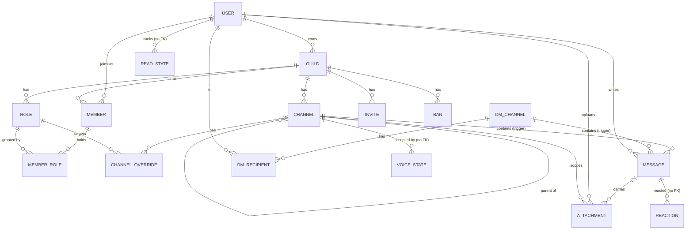

# Retrocast — Data Contracts

Status: Baselined (rev 10)
Related: [SRS](SRS.md) · [Architecture](ARCHITECTURE.md) · [Product Brief](PRODUCT_BRIEF.md)

This document records the data and interface contracts as they exist at commit `6bc385e`
(re-read at `origin/main` 55e50eb in rev 2) and the contract changes rev 2 decides.
Sources: `retrocast/migrations/000001–000020`, `retrocast/internal/models/`,
`retrocast/internal/gateway/events.go`, `retrocast/internal/redis/client.go`,
`retrocast/docs/openapi.yaml` (OpenAPI 3.0.3, 58 operations; `info.version` 2.0.0 from rev 2).
Entities and gateway events retain their existing version unless noted per entity. The REST envelope is v2; API-022/API-027 are `v2.1.0` for storage/linking, with the other operations `v2.0.0` from rev 2:
every success body is wrapped in `data` (§4, §9; SV-IR-007, ADR-013). The code has no
versioning beyond the `/api/v1` prefix, and nothing has been released (Q-003).

## 1. Configuration contract
The server reads configuration from environment variables, which override an optional file,
which overrides the defaults (`retrocast/internal/config/config.go`). The file is the first
found of `$RETROCAST_CONFIG`, `./retrocast.toml` and `/etc/retrocast/config.toml`. It holds
`KEY = VALUE` lines: lines starting with `#` or `[` are skipped and surrounding quotes are
removed, so it is a flat subset of TOML. If `DATABASE_URL` or `JWT_SECRET` is missing the
server stops at start with an error naming the keys.

| Key | Required | Purpose |
|---|---|---|
| `DATABASE_URL` | yes | PostgreSQL connection string |
| `JWT_SECRET` | yes | HMAC key for access tokens (no minimum length is enforced) |
| `REDIS_URL` | no | Redis connection (default `redis://localhost:6379`) |
| `SERVER_ADDR` | no | Listen address (default `:8080`; compose keeps it internal) |
| `LOG_LEVEL` | no | slog level (default `info`) |
| `REGISTRATION_MODE` | no | `open`, `invite` or `closed` (default `invite`); any other value stops the server at start (SV-FR-062). Specified in rev 2, not yet read by the code |
| `ALLOWED_ORIGINS` | no | Comma-separated browser origins allowed besides the server's own (SV-NFR-011). Read from environment or config file; empty by default; exact scheme/host/effective-port match, no wildcards |
| `MINIO_ENDPOINT`, `MINIO_ACCESS_KEY`, `MINIO_SECRET_KEY` | yes for uploads | Object store; bucket `retrocast` is created at start |
| `LIVEKIT_URL`, `LIVEKIT_API_KEY`, `LIVEKIT_API_SECRET` | yes for voice | Token minting (§7.1) |
| `POSTGRES_PASSWORD`, `MINIO_ROOT_PASSWORD` | compose only | Service passwords used by `docker-compose.yml` |
| `DOMAIN` | Caddy only | Site address in `retrocast/Caddyfile` (default `localhost`) |
| `GRAFANA_ADMIN_PASSWORD` | compose only | Grafana admin password (`docker-compose.yml` falls back to a development default) |
| `BACKUP_DIR` | backup script only | Where `scripts/backup.sh` writes archives (default the current directory) |
| `SERVER_URL` | CLI only | Base URL for `retrocast-cli health` (default `http://localhost:8080`; set it to the public `https://` address for compose) |

Values come from `retrocast/.env` (template `retrocast/.env.example`). The example files hold
development defaults; they are not repeated here.

## 2. Conceptual model

`messages.channel_id` is validated against guild or DM parents by locking write triggers (000020); deletion of either parent deletes its messages. Attachments may be pending (`message_id: null`) until API-022 claims them atomically. Guild search excludes DMs.

## 3. Entities

All ids are 64-bit snowflakes (`retrocast/internal/snowflake`) encoded in JSON as decimal
strings (SV-IR-004; D-11 fixed in B2).

| ID | Entity | Store | Fields (constraints) | Integrity | Classification | Requirements | Version |
|---|---|---|---|---|---|---|---|
| ENT-001 | User | PostgreSQL `users` | id PK; username VARCHAR(32) unique (case-sensitive); display_name VARCHAR(32); avatar_hash VARCHAR(64) null; password_hash TEXT (never serialised); created_at | Referenced by guilds.owner_id, messages.author_id, invites.creator_id and bans.created_by without ON DELETE, so a user who owns a guild or wrote a message cannot be deleted (account deletion is Later, CAP-038) | Personal (username, display name); Secret (password hash) | SV-FR-001–SV-FR-004, SV-FR-053, SV-FR-060, SV-FR-062–SV-FR-065, SV-NFR-001 | v1.0.0 |
| ENT-002 | Guild | PostgreSQL `guilds` | id PK; name VARCHAR(100) (2–100 in service); icon_hash VARCHAR(64) null; owner_id FK users; created_at | Deleting a guild cascades to channels, roles, members, invites and bans | Internal | SV-FR-007–SV-FR-013 | v1.0.0 |
| ENT-003 | Channel | PostgreSQL `channels` | id PK; guild_id FK cascade; name VARCHAR(100); type SMALLINT (0 text, 2 voice, 4 category); position INT; topic VARCHAR(1024) null; parent_id FK channels null | UNIQUE(guild_id, name); parent_id has no ON DELETE | Internal | SV-FR-009, SV-FR-014–SV-FR-017 | v1.0.0 |
| ENT-004 | Member | PostgreSQL `members` | PK (guild_id, user_id), both FK cascade; nickname VARCHAR(32) null; joined_at; JSON adds `roles` (role ids as decimal strings) | Cascades to member_roles | Personal (nickname) | SV-FR-020, SV-FR-022–SV-FR-024, SV-FR-063, SV-FR-066, SV-FR-067, SV-FR-071, SV-FR-077 | v1.0.0 |
| ENT-005 | MemberRole | PostgreSQL `member_roles` | PK (guild_id, user_id, role_id); role_id FK roles cascade; (guild_id, user_id) FK members cascade | No check that the role belongs to the same guild at the database level | Internal | SV-FR-008, SV-FR-043, SV-FR-045 | v1.0.0 |
| ENT-006 | Role | PostgreSQL `roles` | id PK; guild_id FK cascade; name VARCHAR(100); color INT; permissions BIGINT bitfield (§3.1); position INT; is_default BOOL (`@everyone`) | — | Internal | SV-FR-008, SV-FR-040–SV-FR-046 | v1.0.0 |
| ENT-007 | ChannelOverride | PostgreSQL `channel_overrides` | PK (channel_id, role_id), both FK cascade; allow_perms BIGINT; deny_perms BIGINT | No check that the role and channel share a guild | Internal | SV-FR-045, SV-FR-047 | v1.0.0 |
| ENT-008 | Message | PostgreSQL `messages` | id PK; channel_id (guild or DM parent, key-share-locking trigger); author_id FK users; content TEXT (1–2000 bytes in service); created_at; edited_at null; search_vector tsvector (English, trigger-maintained, GIN index) |Paging index (channel_id, id DESC); missing parents rejected with 23503; parent delete triggers preserve message/attachment cleanup (D-08 fixed, 000020). Deletes of channels, dm_channels or guilds must run in READ COMMITTED (the app default); under REPEATABLE READ or SERIALIZABLE, a concurrent insert can leave an orphan message. Trigger functions pin search_path to public, pg_temp. | Personal (content) | SV-FR-025–SV-FR-030, SV-FR-055, SV-FR-059 | v1.1.0 |
| ENT-009 | Attachment | PostgreSQL `attachments` | id PK; message_id nullable FK messages cascade; uploader_id FK users NOT NULL; channel_id FK channels cascade NOT NULL; filename, content_type, size, storage_key (never serialised); JSON adds url | Atomic API-022 claim checks uploader, channel and unlinked state; invalid claims roll back with INVALID_ATTACHMENTS. Unlinked rows and objects remain indefinitely; no garbage collector. Index on message_id. D-09 fixed (000020). | Personal (file content) | SV-FR-051, SV-FR-052 | v1.1.0 |
| ENT-010 | Invite | PostgreSQL `invites` | code VARCHAR(8) PK (8 hex characters, 32 random bits); guild_id FK cascade; channel_id FK channels null; creator_id FK users; max_uses INT (0 unlimited); uses INT; expires_at null; created_at | `uses` is incremented without a lock against `max_uses` | Internal | SV-FR-018–SV-FR-021, SV-FR-063 | v1.0.0 |
| ENT-011 | Ban | PostgreSQL `bans` | PK (guild_id, user_id); reason TEXT null; created_by FK users; created_at | — | Personal (reason) | SV-FR-067–SV-FR-069 | v1.0.0 |
| ENT-012 | DMChannel | PostgreSQL `dm_channels` | id PK; type INT (1 DM, 3 group DM); created_at; owner_id BIGINT null (migration 000019, no FK) | Referenced by locking message-parent trigger; delete trigger removes DM messages (000020, D-08 fixed) | Internal | SV-FR-054–SV-FR-058 | v1.0.0 |
| ENT-013 | DMRecipient | PostgreSQL `dm_recipients` | PK (channel_id, user_id), both FK cascade | At most 10 participants per group DM (service); only current recipients can access messages or receive DM message events | Internal | SV-FR-054, SV-FR-056, SV-FR-057 | v1.0.0 |
| ENT-014 | Reaction | PostgreSQL `reactions` | PK (message_id, user_id, emoji); created_at | No foreign keys: rows outlive deleted messages and users | Personal | SV-FR-074, SV-FR-075 | v1.0.0 |
| ENT-015 | ReadState | PostgreSQL `read_states` | PK (user_id, channel_id); last_message_id BIGINT default 0; mention_count INT; updated_at | No foreign keys | Personal | SV-FR-076 | v1.0.0 |
| ENT-016 | VoiceState | PostgreSQL `voice_states` | PK (guild_id, user_id); channel_id; session_id TEXT; self_mute BOOL; self_deaf BOOL; joined_at | No foreign keys; rows stay when a client disconnects without leaving | Personal (presence in a room) | SV-FR-048–SV-FR-050 | v1.0.0 |
| ENT-017 | DeviceToken | PostgreSQL `device_tokens` | id BIGSERIAL PK; user_id FK cascade; platform VARCHAR(16); token TEXT; UNIQUE(user_id, token) | No code reads or writes it | Secret (push token) | none (push is Later, with the iOS client: Q-025) | v1.0.0 |
| ENT-018 | RefreshTokenRow | PostgreSQL `refresh_tokens` | token VARCHAR(64) PK; user_id FK cascade; expires_at; created_at | No code reads or writes it; refresh tokens live in Redis (ENT-019) | Secret | none | v1.0.0 |
| ENT-019 | RefreshToken | Redis | key `refresh:{token}` (token = 32 random bytes, hex); value user id; TTL 7 days | Read then deleted on refresh (two commands, not atomic); no per-user index, which SV-FR-061 needs | Secret | SV-FR-005, SV-FR-006, SV-FR-061, SV-NFR-002 | v1.0.0 |
| ENT-020 | Presence | Redis | key `presence:{user id}`; value status; TTL 5 minutes | Set on IDENTIFY, successful RESUME and op 3; authenticated heartbeats extend the existing status TTL | Personal | SV-FR-032–SV-FR-034 | v1.0.0 |
| ENT-021 | RateLimitCounter and TypingMarker | Redis | `rl:user:{user id}:{route}` or `rl:ip:{client ip}:{route}`, one-minute window (Lua script); `typing:{channel id}:{user id}`, TTL 10 s | Ephemeral; the client IP is Echo's `RealIP` (SV-NFR-009) | Internal | SV-NFR-003, SV-NFR-009, SV-NFR-010, SV-FR-031 | v1.0.0 |
| ENT-022 | StoredObject | MinIO bucket `retrocast` | key `attachments/{channel id}/{attachment id}/{filename}`; content type from upload | Unlinked uploads and objects remain indefinitely; linked-message deletion removes metadata but does not remove objects. Metadata insert failure triggers best-effort object deletion, which can leave an orphan if cleanup fails. | Personal (file content) | SV-FR-051, SV-FR-052 | v1.1.0 |

### 3.1 Permission bits (ENT-006, ENT-007)
Source: `retrocast/internal/permissions/bitfield.go`.

| Bit | Name | Bit | Name |
|---|---|---|---|
| 0 | VIEW_CHANNEL | 10 | MUTE_MEMBERS |
| 1 | SEND_MESSAGES | 11 | DEAFEN_MEMBERS |
| 2 | MANAGE_MESSAGES | 12 | MOVE_MEMBERS |
| 3 | MANAGE_CHANNELS | 13 | MENTION_EVERYONE |
| 4 | MANAGE_ROLES | 14 | ATTACH_FILES |
| 5 | KICK_MEMBERS | 15 | READ_MESSAGE_HISTORY |
| 6 | BAN_MEMBERS | 16 | CREATE_INVITE |
| 7 | MANAGE_GUILD | 17 | CHANGE_NICKNAME |
| 8 | CONNECT | 18 | MANAGE_NICKNAMES |
| 9 | SPEAK | 31 | ADMINISTRATOR (bypasses every check) |

`DefaultEveryonePerms` (bitfield.go:46) is VIEW_CHANNEL, SEND_MESSAGES, READ_MESSAGE_HISTORY,
CONNECT, SPEAK, CREATE_INVITE and CHANGE_NICKNAME: bits 0, 1, 8, 9, 15, 16 and 17, value
230147 (`0x38303`). Rev 2 makes it the `@everyone` default for new guilds (SV-FR-008, Q-014).
Guild creation uses that default (PR #44, D-27 fixed); existing guilds keep their stored permissions. `PermAll` is `0x7FFFFFFFFFFFFFFF`. The legacy
docs/legacy/permissions.md gives the default as `0x10307`, which does not match these bits.

### 3.2 Permission resolution
Source: `retrocast/internal/permissions/resolver.go`; called by
`retrocast/internal/service/permission.go`.

1. **Owner.** The guild owner has every permission.
2. **Base permissions.** The `@everyone` role's permissions OR the permissions of every role
   the member holds. If the result has ADMINISTRATOR, the member has `PermAll` and steps 3–5
   are skipped.
3. **`@everyone` channel override.** Remove its deny bits, then add its allow bits.
4. **Role channel overrides.** OR together the allow bits of every override for a role the
   member holds, and separately their deny bits; remove the combined deny, then add the
   combined allow.
5. The result is the member's permission set in that channel.

Guild-scoped checks (`RequireGuildPermission`) delegate to `RequireGuildPermissionByPerm`
and use step 2, including the default role even when no member-role row exists (PR #44, D-04 fixed). The guild owner is never subject to the role
hierarchy (SV-FR-070).

SV-FR-078 limits non-owner, non-Administrator role managers to this guild base permission set when creating/updating/deleting roles, assigning/removing roles, replacing member roles or setting override allow bits. Updates check the union of current and requested permission bits; deletions check current bits. Member replacements check and write only added or removed roles, preserving unchanged roles; all role validation precedes nickname or role writes. Channel overrides never expand the grantable set. The @everyone position stays 0 for every caller.

### 3.3 Snowflake ids
Source: `retrocast/internal/snowflake/snowflake.go`. 64 bits: 42 bits of milliseconds since
the epoch 2025-01-01T00:00:00Z (1735689600000), 5 bits worker id, 5 bits process id and 12
bits sequence. The server runs with worker 1 and process 1. Ids sort by creation time and are
sent in JSON as decimal strings (SV-IR-004).

## 4. REST operations

Base path `/api/v1`; JSON bodies; `Authorization: Bearer <access token>` on every operation
except API-001–API-003 and API-049. Every operation is version v2.0.0 (rev 2): every success
body is `{"data": …}` and a 204 has no body (SV-IR-007, ADR-013, §9). The "Wrapped today"
column shows the implemented v2.0.0 response shape. Status codes
are as documented in OpenAPI; where the code differs, the Notes column says so.

| ID | Operation | Method and path | Success | Wrapped today | Notes | Requirements |
|---|---|---|---|---|---|---|
| API-001 | register | POST /auth/register | 200 tokens + user | yes | the legacy api.md said 201; optional `invite_code` (rev 2, used in mode `invite`); 403 `INVITE_REQUIRED`, `INVALID_INVITE` or `REGISTRATION_CLOSED` by mode | SV-FR-001–SV-FR-003, SV-FR-062–SV-FR-065, SYS-CON-002 |
| API-002 | login | POST /auth/login | 200 tokens + user | yes | | SV-FR-004 |
| API-003 | refreshToken | POST /auth/refresh | 200 token pair | yes | | SV-FR-005 |
| API-004 | logout | POST /auth/logout | 204 | — | | SV-FR-006 |
| API-005 | getMe | GET /users/@me | 200 user | yes | | SV-FR-053 |
| API-006 | updateMe | PATCH /users/@me | 200 user | yes | | SV-FR-053 |
| API-007 | listMyGuilds | GET /users/@me/guilds | 200 guilds | yes | | SV-FR-013 |
| API-008 | createDM | POST /users/@me/channels | 200 DM channel | yes | `recipient_id` (DM) or `recipient_ids` (group) | SV-FR-054, SV-FR-056 |
| API-009 | listDMs | GET /users/@me/channels | 200 DM channels | yes | | SV-FR-058 |
| API-010 | addGroupDMMember | PUT /channels/{channelId}/recipients/{userId} | 204 | — | | SV-FR-057 |
| API-011 | removeGroupDMMember | DELETE /channels/{channelId}/recipients/{userId} | 204 | — | | SV-FR-057 |
| API-012 | getReadStates | GET /users/@me/read-states | 200 read states | yes | | SV-FR-076 |
| API-013 | createGuild | POST /guilds | 201 guild | yes | | SV-FR-007–SV-FR-009 |
| API-014 | getGuild | GET /guilds/{guildId} | 200 guild | yes | | SV-FR-010 |
| API-015 | updateGuild | PATCH /guilds/{guildId} | 200 guild | yes | | SV-FR-011 |
| API-016 | deleteGuild | DELETE /guilds/{guildId} | 204 | — | | SV-FR-012 |
| API-017 | createChannel | POST /guilds/{guildId}/channels | 201 channel | yes | | SV-FR-014, SV-FR-017 |
| API-018 | listChannels | GET /guilds/{guildId}/channels | 200 channels | yes | | SV-FR-009, SV-FR-016 |
| API-019 | getChannel | GET /channels/{channelId} | 200 channel | yes | | SV-FR-016 |
| API-020 | updateChannel | PATCH /channels/{channelId} | 200 channel | yes | | SV-FR-015 |
| API-021 | deleteChannel | DELETE /channels/{channelId} | 204 | — | | SV-FR-015 |
| API-022 | sendMessage | POST /channels/{channelId}/messages | 201 message | yes | Optional attachment_ids: decimal-string upload ids; requires ATTACH_FILES when supplied; atomic owner/channel/unlinked claim; 400 INVALID_ATTACHMENTS on invalid claims; content remains 1–2000 bytes | SV-FR-025, SV-FR-055 |
| API-023 | getMessages | GET /channels/{channelId}/messages | 200 messages | yes | Attachments batched with each page; empty attachments is []; existing internal URLs (D-10) | SV-FR-027, SV-FR-052 |
| API-024 | getMessage | GET /channels/{channelId}/messages/{messageId} | 200 message | yes | | SV-FR-028 |
| API-025 | editMessage | PATCH /channels/{channelId}/messages/{messageId} | 200 message | yes | | SV-FR-029 |
| API-026 | deleteMessage | DELETE /channels/{channelId}/messages/{messageId} | 204 | — | | SV-FR-030 |
| API-027 | uploadAttachment | POST /channels/{channelId}/attachments | 201 attachment | yes | Guild upload; Q-017 types only, at most 10 MB; returns pending attachment (message_id null); link through API-022 attachment_ids | SV-FR-051 |
| API-028 | triggerTyping | POST /channels/{channelId}/typing | 204 | — | MessageService.Typing: guild SEND_MESSAGES after overrides; DM participants only; 403 for unauthorized callers, 404 for unknown channels; writes Redis marker before dispatch | SV-FR-031 |
| API-029 | ackMessage | PUT /channels/{channelId}/ack/{messageId} | 204 | — | | SV-FR-076 |
| API-030 | addReaction | PUT /channels/{channelId}/messages/{messageId}/reactions/{emoji}/@me | 204 | — | | SV-FR-074 |
| API-031 | removeReaction | DELETE /channels/{channelId}/messages/{messageId}/reactions/{emoji}/@me | 204 | — | | SV-FR-074 |
| API-032 | getReactions | GET /channels/{channelId}/messages/{messageId}/reactions/{emoji} | 200 users | yes | user ids as decimal strings (D-11 fixed in PR #45) | SV-FR-075 |
| API-033 | listMembers | GET /guilds/{guildId}/members | 200 members | yes | `limit` 1–100 (50), `offset` | SV-FR-023 |
| API-034 | updateSelf | PATCH /guilds/{guildId}/members/@me | 200 member | yes | nickname; no `CHANGE_NICKNAME` check | SV-FR-077 |
| API-035 | leaveGuild | DELETE /guilds/{guildId}/members/@me | 204 | — | owner gets 403 | SV-FR-022 |
| API-036 | getMember | GET /guilds/{guildId}/members/{userId} | 200 member | yes | | SV-FR-024 |
| API-037 | updateMember | PATCH /guilds/{guildId}/members/{userId} | 200 member | yes | nickname, roles; validate role changes before writes; unchanged roles preserved | SV-FR-043, SV-FR-077 |
| API-038 | kickMember | DELETE /guilds/{guildId}/members/{userId} | 204 | — | KICK_MEMBERS, strict hierarchy and owner protection; self kick returns 400 CANNOT_KICK_SELF | SV-FR-066, SV-FR-070 |
| API-039 | createRole | POST /guilds/{guildId}/roles | 201 role | yes | | SV-FR-040 |
| API-040 | listRoles | GET /guilds/{guildId}/roles | 200 roles | yes | membership required; non-members receive 404 | SV-FR-044 |
| API-041 | updateRole | PATCH /guilds/{guildId}/roles/{roleId} | 200 role | yes | MANAGE_ROLES, same-guild role, hierarchy and grant limit on current plus requested bits; @everyone position fixed at 0 | SV-FR-041 |
| API-042 | deleteRole | DELETE /guilds/{guildId}/roles/{roleId} | 204 | — | `@everyone` gives 403 `CANNOT_DELETE`; MANAGE_ROLES, same-guild role, hierarchy and grant limit on current bits required | SV-FR-042 |
| API-043 | assignRole | PUT /guilds/{guildId}/members/{userId}/roles/{roleId} | 204 | — | | SV-FR-043 |
| API-044 | removeRole | DELETE /guilds/{guildId}/members/{userId}/roles/{roleId} | 204 | — | | SV-FR-043 |
| API-045 | setChannelOverride | PUT /channels/{channelId}/permissions/{roleId} | 200 override | yes | channel MANAGE_ROLES and same-guild role required; allow bits limited to guild base permissions unless owner or Administrator (SV-FR-078) | SV-FR-047 |
| API-046 | deleteChannelOverride | DELETE /channels/{channelId}/permissions/{roleId} | 204 | — | channel MANAGE_ROLES and same-guild role required | SV-FR-047 |
| API-047 | createInvite | POST /guilds/{guildId}/invites | 201 invite | yes | `max_age_seconds` default 86 400, `max_uses` default 0 | SV-FR-018 |
| API-048 | listInvites | GET /guilds/{guildId}/invites | 200 invites | yes | | SV-FR-021 |
| API-049 | getInvite | GET /invites/{code} | 200 invite preview | yes | public; expired gives 404 `EXPIRED`; 5 requests per minute per client IP; Redis outage returns 503 | SV-FR-019, SV-NFR-003 |
| API-050 | acceptInvite | POST /invites/{code} | 200 guild | yes | code also returns 410 and 403 `BANNED`, which OpenAPI omits | SV-FR-020 |
| API-051 | revokeInvite | DELETE /invites/{code} | 204 | — | | SV-FR-021 |
| API-052 | listBans | GET /guilds/{guildId}/bans | 200 bans | yes | | SV-FR-068 |
| API-053 | banMember | PUT /guilds/{guildId}/bans/{userId} | 204 | — | body `{"reason": string or null}` | SV-FR-067, SV-FR-070 |
| API-054 | unbanMember | DELETE /guilds/{guildId}/bans/{userId} | 204 | — | | SV-FR-069 |
| API-055 | searchMessages | GET /guilds/{guildId}/messages/search | 200 messages | yes | `q`, `author_id`, `before`, `after`, `limit` 1–100 (25) | SV-FR-059 |
| API-056 | joinVoice | POST /channels/{channelId}/voice/join | 200 token + voice states | yes | no LiveKit URL in the response | SV-FR-048, SV-IR-006 |
| API-057 | leaveVoice | POST /channels/{channelId}/voice/leave | 204 | — | | SV-FR-049 |
| API-058 | getVoiceStates | GET /channels/{channelId}/voice/states | 200 voice states | yes | | SV-FR-050 |
| API-059 | changePassword | PUT /users/@me/password | 200 tokens + user | — | added rev 2, not built; body `current_password`, `new_password`; 403 `INVALID_CREDENTIALS`, 400 `INVALID_PASSWORD`; credential rate limit | SV-FR-060, SV-FR-061 |

Routes outside `/api/v1`: `GET /health`, `GET /metrics` (Prometheus), `GET /docs`,
`GET /docs/openapi.yaml`, `GET /gateway` (WebSocket upgrade).

API-022 and API-027 storage/link additions are contract v2.1.0 (driver E116); linked ids remain strings and pending message_id is null. REST v2 envelopes and /api/v1 remain unchanged.

## 5. Error model
Handler errors use `{"error": {"code": "<CODE>", "message": "<text>"}}`
(`retrocast/internal/api/response.go`). Service error kinds map to statuses: not found 404,
forbidden 403, role hierarchy 403, bad request 400, conflict 409, unauthorized 401, gone 410,
anything else 500 `INTERNAL`. Rate limiting returns 429 `RATE_LIMITED` with `Retry-After`.
`HTTPErrorHandler` normalizes errors raised by Echo, JWT middleware and recovery
from panics into the same envelope (SV-IR-003). Rate-limit failures also use the envelope;
429 responses retain `Retry-After`. Internal details are redacted for 5xx errors.

| Status | Framework error code |
|---|---|
| 400 | `BAD_REQUEST` |
| 401 | `UNAUTHORIZED` |
| 403 | `FORBIDDEN` |
| 404 | `NOT_FOUND` |
| 405 | `METHOD_NOT_ALLOWED` |
| 413 | `PAYLOAD_TOO_LARGE` |
| 429 | `RATE_LIMITED` |
| Other 4xx (for example 415, 416, 422) | `BAD_REQUEST` |
| 5xx or non-HTTP error | `INTERNAL` |

Service/handler errors retain their specific codes below. REST contract v2.0.0 keeps
the error envelope; success bodies use the data envelope.

Codes in use: `UNAUTHORIZED`, `BAD_REQUEST`, `METHOD_NOT_ALLOWED`, `PAYLOAD_TOO_LARGE`,
`INVALID_POSITION`, `INVALID_USERNAME`, `INVALID_PASSWORD`, `USERNAME_TAKEN`,
`INVALID_CREDENTIALS`, `MISSING_TOKEN`, `INVALID_TOKEN`, `INVALID_NAME`, `INVALID_TYPE`,
`INVALID_CONTENT`, `INVALID_CHANNEL`, `NOT_VOICE_CHANNEL`, `INVALID_DISPLAY_NAME`,
`INVALID_NICKNAME`, `INVALID_ROLE`, `INVALID_EMOJI`, `INVALID_QUERY`, `INVALID_RECIPIENT`,
`INVALID_RECIPIENTS`, `MAX_MEMBERS`, `FILE_TOO_LARGE`, `INVALID_CONTENT_TYPE`,
`CANNOT_BAN_SELF`, `CANNOT_DELETE`, `NOT_FOUND`, `EXPIRED`, `MAX_USES`, `ALREADY_MEMBER`,
`BANNED`, `FORBIDDEN`, `MISSING_PERMISSIONS`, `ROLE_HIERARCHY`, `RATE_LIMITED`, `INTERNAL`.

`INVALID_POSITION` is 400 for a negative role position or an attempt to move @everyone away from position 0 (SV-FR-008, SV-FR-078). Grant-limit failures return 403 `MISSING_PERMISSIONS`.

Codes added in rev 2 (specified; CANNOT_KICK_SELF implemented in PR #44):

| Code | Status | Meaning | Requirement |
|---|---|---|---|
| `INVITE_REQUIRED` | 403 | Mode `invite` and no `invite_code` | SV-FR-063, SV-FR-065 |
| `INVALID_INVITE` | 403 | The invite code at registration is unknown, expired, revoked or used up | SV-FR-063 |
| `REGISTRATION_CLOSED` | 403 | Mode `closed` | SV-FR-064 |
| `CANNOT_KICK_SELF` | 400 | A member tried to kick themself | SV-FR-070 |
| `SERVICE_UNAVAILABLE` | 503 | Redis is unreachable on a rate-limited unauthenticated route | SV-NFR-010 |
| `NO_SHARED_GUILD` | 403 | A DM or group DM names a user who shares no guild with the caller | SV-FR-054, SV-FR-056, SV-FR-057 |

`INVALID_ATTACHMENTS` (400): one generic API-022 refusal for unknown, duplicate, foreign-owner, wrong-channel or already-linked attachment ids; no ownership details are returned.

## 6. Gateway events

Endpoint `GET /gateway` (WebSocket). Every frame is `{"op": int, "d": any, "s": int, "t": string}`;
`s` and `t` are set on dispatches (op 0) only. Sequence numbers are per connection for live
dispatches. Each session retains its last 100 serialized dispatches for 5 minutes after disconnect; replay preserves their sequence numbers (PR #50). Gateway contract v1.1.0 adds an optional READY presence snapshot; existing frames remain compatible.

Connection parameters (`retrocast/internal/gateway/connection.go:13–19`): the upgrade needs no
token; the client authenticates with IDENTIFY. Heartbeat interval 41 250 ms; the server also
sends op 1 every interval and closes a connection whose last acknowledgement is older than the
interval plus 10 s. Frames are read up to 4 096 bytes; writes time out after 10 s; the read
deadline is 60 s from the last pong; each connection buffers up to 256 outgoing frames. From
rev 2 a user may hold several connections, each receiving every event for that user
(SV-FR-072), and subscriptions follow membership changes (SV-FR-071).

| ID | Op | Name | Direction | Payload `d` | Requirements |
|---|---|---|---|---|---|
| EVT-001 | 10 | HELLO | server → client | `heartbeat_interval` (41 250 ms) | SV-FR-035 |
| EVT-002 | 2 | IDENTIFY | client → server | `token` (access token) | SV-FR-036 |
| EVT-003 | 0 | READY | server → client | `session_id`, `user_id`, `guilds` (ids as decimal strings, D-11 fixed in PR #45), `read_states`, optional `presences` array of `{user_id,status}` for online/idle/dnd members sharing a guild (invisible omitted) | SV-FR-036, SV-FR-032 |
| EVT-004 | 1 | HEARTBEAT | both ways | last sequence (from the client); none (from the server) | SV-FR-037 |
| EVT-005 | 11 | HEARTBEAT_ACK | server → client | none | SV-FR-037 |
| EVT-006 | 6 | RESUME | client → server | `token`, `session_id`, `seq`; validate token as IDENTIFY. Replay only this user's session, with original sequence numbers. Unknown/expired/foreign sessions, active session reuse, membership changes or sequence gaps receive fresh READY with new session_id, sequence 1 and full current snapshot; replay nothing from the rejected session | SV-FR-038 |
| EVT-007 | 7 | RECONNECT | server → client | none; available for server-initiated reconnects. A second IDENTIFY does not displace another device (PR #50) | SV-FR-038, SV-FR-072 |
| EVT-008 | 3 | PRESENCE_UPDATE (client) | client → server | `status`: online, idle, dnd, invisible | SV-FR-033 |
| EVT-009 | 0 | MESSAGE_CREATE | server → client | message with author fields | SV-FR-026, SV-FR-055, SV-FR-071, SV-FR-072 |
| EVT-010 | 0 | MESSAGE_UPDATE | server → client | message | SV-FR-029 |
| EVT-011 | 0 | MESSAGE_DELETE | server → client | `id`, `channel_id` | SV-FR-030 |
| EVT-012 | 0 | GUILD_CREATE | server → client | guild (to the creator only) | SV-FR-007 |
| EVT-013 | 0 | GUILD_UPDATE | server → client | guild | SV-FR-011 |
| EVT-014 | 0 | GUILD_DELETE | server → client | `id` | SV-FR-012 |
| EVT-015 | 0 | CHANNEL_CREATE | server → client | channel (guild members) or DM channel (each recipient) | SV-FR-014, SV-FR-054 |
| EVT-016 | 0 | CHANNEL_UPDATE | server → client | channel | SV-FR-015 |
| EVT-017 | 0 | CHANNEL_DELETE | server → client | `id`, `guild_id` (guild-wide metadata, regardless of VIEW_CHANNEL) or DM channel (participants only) | SV-FR-015 |
| EVT-018 | 0 | GUILD_MEMBER_ADD | server → client | member | SV-FR-020 |
| EVT-019 | 0 | GUILD_MEMBER_REMOVE | server → client | `guild_id`, `user_id` | SV-FR-022, SV-FR-066, SV-FR-067, SV-FR-071 |
| EVT-020 | 0 | GUILD_MEMBER_UPDATE | server → client | member | SV-FR-043 |
| EVT-021 | 0 | GUILD_ROLE_CREATE | server → client | `guild_id`, `role` | SV-FR-040 |
| EVT-022 | 0 | GUILD_ROLE_UPDATE | server → client | `guild_id`, `role` | SV-FR-041 |
| EVT-023 | 0 | GUILD_ROLE_DELETE | server → client | `guild_id`, `role_id` | SV-FR-042 |
| EVT-024 | 0 | TYPING_START | server → client | `channel_id`, `guild_id`, `user_id`, `timestamp` | SV-FR-031 |
| EVT-025 | 0 | PRESENCE_UPDATE | server → client | `user_id`, `status` (invisible shown as offline) | SV-FR-032–SV-FR-034 |
| EVT-026 | 0 | VOICE_STATE_UPDATE | server → client | voice state on join; `guild_id`, `channel_id` null, `user_id` on leave | SV-FR-048, SV-FR-049 |
| EVT-027 | 0 | GUILD_BAN_ADD | server → client | ban | SV-FR-067 |
| EVT-028 | 0 | GUILD_BAN_REMOVE | server → client | `guild_id`, `user_id` | SV-FR-069 |
| EVT-029 | 0 | MESSAGE_REACTION_ADD | server → client | reaction | SV-FR-074 |
| EVT-030 | 0 | MESSAGE_REACTION_REMOVE | server → client | reaction | SV-FR-074 |

Gateway fan-out visibility (PR #50 round 2; existing channel-list visibility retained):

| Events | Audience |
|---|---|
| MESSAGE_CREATE/UPDATE/DELETE, reactions, TYPING_START, CHANNEL_UPDATE, voice join | Current guild members with VIEW_CHANNEL on the referenced channel |
| CHANNEL_CREATE, CHANNEL_DELETE, GUILD_*, member/role changes, presence, voice leave without a channel | Current guild members, all their connections; channel metadata matches the existing REST channel list |
| DM events | Current DM participants, all their connections |

Only definitive permission results are cached. A transient lookup fault withholds the event, increments the gateway permission-failure counter, invalidates that session's replay window and closes its connection. RESUME receives fresh READY so clients refetch. A join or removal while disconnected also forces fresh READY even if no later event was missed; live devices update their subscriptions in place. IDENTIFY retries its guild lookup if a join or removal changes the user membership epoch before registration.

Op 4 (`OpVoiceStateUpdate`) is defined in `events.go:15` but the server does not handle it.
Op 5 is unused.

## 7. External contracts

### 7.1 LiveKit
The server mints LiveKit access tokens itself (no SDK; `retrocast/internal/service/voice.go:178`):
HS256 signed with `LIVEKIT_API_SECRET`, `iss` = API key, `sub` = user id, name = username,
`exp` = 24 hours, grant `video.roomJoin` for room `voice-{channel id}`. The server does not
check `SPEAK` in the grant and receives no LiveKit webhooks, so voice state is only what
clients report (SV-FR-049). Clients need the LiveKit URL, which API-056 does not return.

### 7.2 MinIO (S3-compatible)
`retrocast/internal/storage/minio.go` uploads to bucket `retrocast` and builds URLs as
`http://{MINIO_ENDPOINT}/retrocast/{key}`. `MINIO_ENDPOINT` is an address inside the compose
network, so clients outside it cannot fetch those URLs (D-10). Rev 2 decides short-lived
pre-signed URLs for upload and download, valid 15 minutes and served through the public entry
point (Q-011; SV-FR-051, SV-FR-052; ADR-019); attachments are Later.

### 7.3 Apple Push Notification service
Not integrated. `device_tokens` (ENT-017) exists without code. Push notifications are Later,
together with the iOS client (Q-025); APNs is the one optional outside service GOAL-004 allows.

## 8. Classification and retention
- Secret: password hashes, refresh tokens, device tokens, every value in `.env`.
- Personal: usernames, display names, nicknames, message content, attachments, presence,
  voice state, reactions, read states, ban reasons.
- Internal: guild, channel, role and invite metadata.
- Retention: nothing is deleted on a schedule. Messages and attachments are kept until
  their author or a moderator deletes them (Q-021). Accounts are kept; account deletion is
  Later (CAP-038, Q-022). Redis keys expire by TTL (§3).
- Backups contain every Secret and Personal item stored in PostgreSQL and MinIO. They are
  made daily and kept 30 days (SYS-FR-002, SYS-FR-003); Redis is not backed up (ADR-018), so
  a restore signs every user out.

## 9. Migrations and deprecations
- 20 numbered pairs in `retrocast/migrations` (golang-migrate, `file://migrations`), applied at
  server start and by CI before the tests (SV-NFR-007).
- `docs/legacy/database.md` describes 14 migrations; it predates 000015–000019.
- Changing a contract above means a new migration and a revision of this document.

| Rev | Contract | From | To | Change | Clients | Decision |
|---|---|---|---|---|---|---|
| 2 | REST operations (§4) | v1.0.0 | v2.0.0 (breaking) | Every success body is `{"data": …}`; the formerly bare auth, DM, read-state, message, upload, reaction-list, role, override, invite, ban-list, search and voice operations change shape; 204 responses have no body; error bodies are unchanged; the path stays `/api/v1` | No parallel v1 shape is served. The web client already reads `data` (empty 204 handling fixed in B2, D-29). The iOS client accepts both shapes except on refresh, which v2.0.0 fixes; its update is tracked when the iOS client is scheduled | Q-010 (owner); ADR-013 (driver); implemented in PR #45 |
| 2 | API-001 register | v1.0.0 | v2.0.0 | Optional `invite_code`; 403 codes by registration mode | Web register page gains the field (WEB-FR-020) | Q-012; ADR-014 |
| 2 | EVT-007 RECONNECT | v1.0.0 | v1.0.0 (frame unchanged) | Sent in fewer cases: not for a second IDENTIFY | A client that reads op 7 as "signed in elsewhere" must not | Q-009; ADR-017 |
| 9 | API-022 / API-027, ENT-008/009/012/013/022 | REST v2.0.0 | REST v2.1.0 |Migration 000020: DM parent validation/delete triggers; nullable pending upload link with ownership backfill; attachment_ids atomic claim and batched hydration. After a refused down, the schema remains at 20 while golang-migrate marks version 19 dirty: run `migrate force 20` to recover; `force 19` then `up` fails. | Web sends uploaded ids with nonempty text; pending message_id is null; existing linked ids stay strings; down refuses while DM messages or pending attachments exist | Driver E116; Q-017; D-08/D-09/D-22 |

| 11 | EVT-003 / EVT-006 gateway | v1.0.0 | v1.1.0 (compatible) | READY gains optional presences. RESUME frames unchanged; fresh READY with a new session id signals unavailable replay, sequences restart at 1. Last 100 events per session, retained 5 minutes after disconnect; authorization changes invalidate old history | Web refetches open-channel recent messages after fallback READY. iOS already accepts READY; reconnect catch-up refresh is a follow-up | Driver B3 decision; PR #50 |

## Revision history
| Rev | Date | Commit | Mode | Summary |
|---|---|---|---|---|
| 1 | 2026-11-23T12:58:05-05:00 | 918f0a8471d3 | INIT | Initial contracts ENT-001–ENT-022, API-001–API-058, EVT-001–EVT-030 |
| 2 | 2026-11-23T15:17:07-05:00 | 701009f47d68 | REVISION | Status Baselined; REST contract v2.0.0 (all success bodies in data, ADR-013); API-059; §3.2 permission resolution, §3.3 snowflake ids; new config keys and error codes; §9 migrations |
| 4 | 2026-11-23T15:52:00-05:00 | c350426f94c5 | REVISION | PR #44: permission management, default roles, channel search filtering, checked typing and kick hierarchy; residual B3 delivery gaps recorded |
| 5 | 2026-11-23T16:25:23-05:00 | 7af05226f577 | REVISION | PR #44 round 2: SV-FR-078 grant limits, fixed default-role position, API notes and restored evidence |
| 6 | 2026-11-23T16:57:25-05:00 | 3444c6dce8b6 | REVISION | PR #44 round 3: protect current role permissions on update/delete; member role deltas and validation before writes; evidence and UI corrections |
| 7 | 2026-11-23T17:24:36-05:00 | 001716422223 | REVISION | PR #45: REST v2 envelopes and string ids; web Pilot flow fixes; API-059 and role ordering remain partial |
| 8 | 2026-11-23T18:35:55-05:00 | 8c86806c1499 | REVISION | PR #45 round 2: optional configuration, unified error mapping, API-059/B5 remainder and unconditional local sign-out |
| 9 | 2026-11-23T19:23:21-05:00 | f3f6d6f7bafd | REVISION | B2b: migration 000020 repairs DM parent integrity and pending attachment linking; Q-017 types and D-31 route binding fixed; storage/retention limits and Later delivery retained |
| 10 | 2026-11-23T20:11:25-05:00 | e40076472143 | REVISION | PR #48 round 2: down-refusal recovery, READ COMMITTED parent-delete requirement, pinned trigger lookup, updated DM delivery and uploader-delete blockers, repaired table rows |
| 11 | 2026-11-23T20:32:22-05:00 | c2f7642e7b8c | REVISION | PR #50: live subscriptions, VIEW_CHANNEL fan-out, multiple connections, session replay/fresh READY fallback and presence snapshot/TTL; ADR-017 built |
| 12 | 2026-11-23T21:36:57-05:00 | 42acac2a86f3 | REVISION | PR #50 round 2: fault-driven READY resynchronization, membership epoch retries, guild-wide channel create/delete metadata; SV-FR-031 delivery corrected |
| 13 | 2026-11-23T22:26:18-05:00 | e2467ea2f2de | REVISION | PR #50 round 3: join epochs, away-device READY after joins, resync invalidation regression; corrected this PR's contract revision numbering |
| 14 | 2026-11-23T22:54:35-05:00 | f4e6409e92a2 | REVISION | PR #53: deployment exposure, origins, outage policy, invite limit, LiveKit defaults and raw OpenAPI; D-10 and API-059 remain separate |
